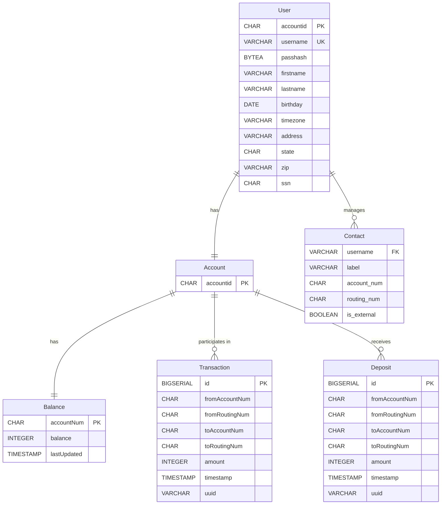
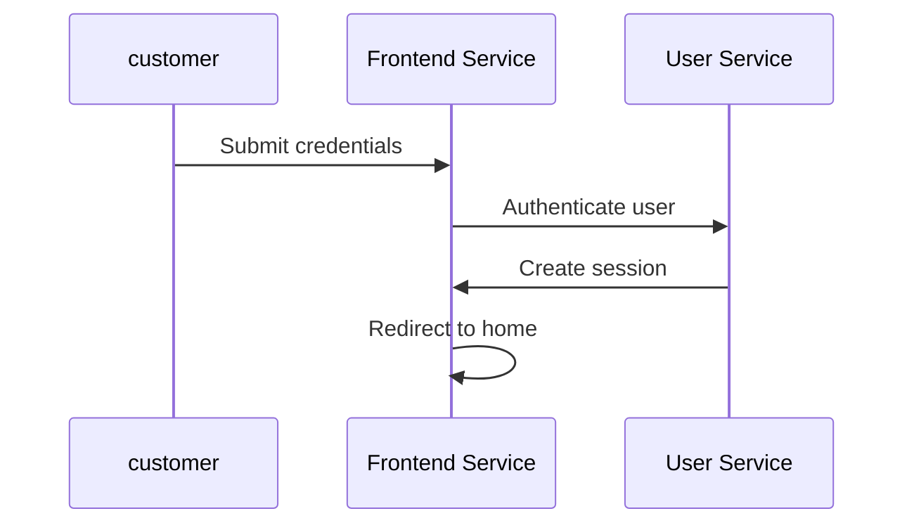
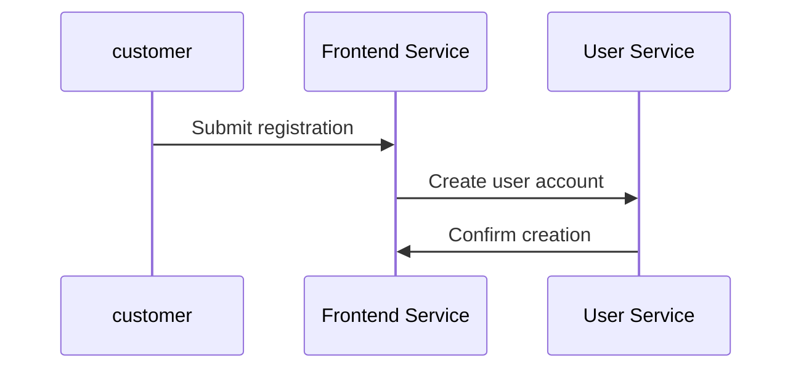
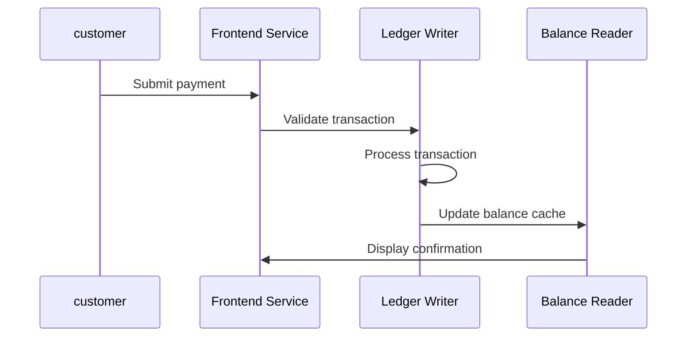
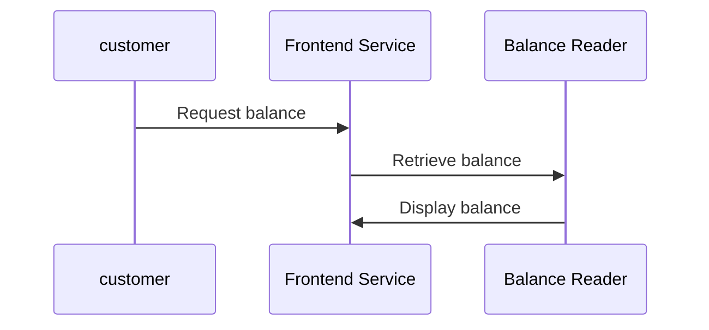
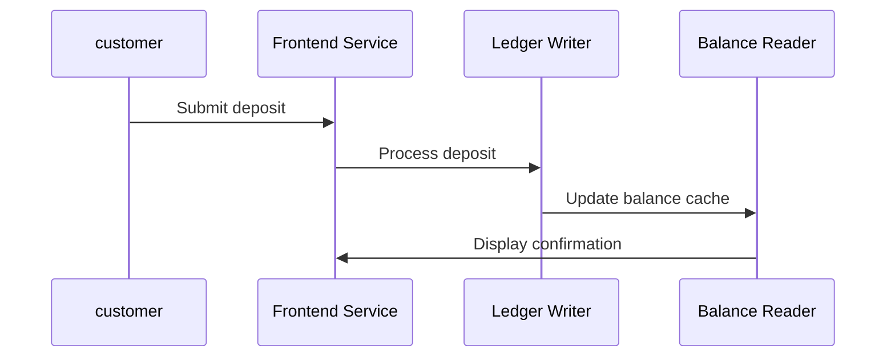
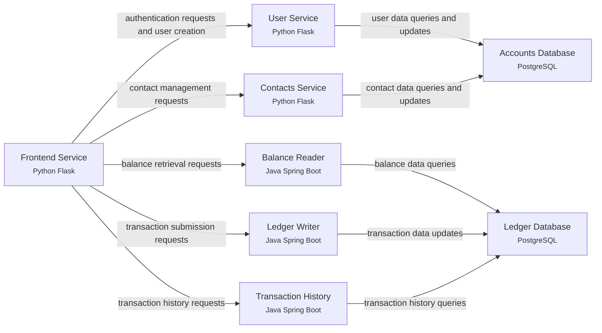

# Business Requirements Document — Bank of Anthos

> Reverse-engineered by Phoenix.ai from the system's own artifacts. Every requirement below is traced to the file and line it was read from; elements marked **inferred** were reasoned by the model and need confirmation.

| Item              | Value                                                                                                                                 |
| ----------------- | ------------------------------------------------------------------------------------------------------------------------------------- |
| Source            | uploaded inputs (inputs/indian-banking-system) @ `uploads`                                                                            |
| Generated         | Thu, 12 Nov 2026 09:11:57 GMT (z.ai, glm-4.5-flash)                                                                                   |
| Evidence read     | 16 files, 0 screenshots, 57 log events, 16 telemetry signals                                                                          |
| Extracted         | 4 domains · 6 entities · 12 activities · 5 flows · 3 personas · 4 journeys · 15 reports · 12 capabilities · 6 epics · 37 user stories |
| Confidence legend | high ≥ 80% · medium ≥ 60% · low < 60% · inferred = no direct evidence                                                                 |

## Contents

1. [Executive summary](#1-executive-summary)
2. [Business context, objectives & scope](#2-business-context-objectives--scope)
3. [Module coverage](#3-module-coverage)
4. [Business domains](#4-business-domains)
5. [Domain model](#5-domain-model)
6. [Actions & activities](#6-actions--activities)
7. [Execution & business flows](#7-execution--business-flows)
8. [Personas & user journeys](#8-personas--user-journeys)
9. [Reports](#9-reports)
10. [Capabilities, epics & user stories](#10-capabilities-epics--user-stories)
11. [Business rules](#11-business-rules)
12. [Architecture, integrations & NFRs](#12-architecture-integrations--nfrs)
13. [Gaps, risks, assumptions & open questions](#13-gaps-risks-assumptions--open-questions)
14. [Glossary](#14-glossary)

## 1. Executive summary

Bank of Anthos is a cloud-native microservices-based online banking platform that allows customers to open accounts, check balances, make payments, and manage contacts. The system provides a modern, scalable online banking experience with account management, payments, and transaction history capabilities. It enables customers to perform basic banking functions through a web interface, including user authentication, account creation, balance viewing, payment processing, deposit handling, and contact management.

## 2. Business context, objectives & scope

Bank of Anthos was rebuilt as cloud services to provide a modern online banking experience. The platform allows customers to perform basic banking functions without visiting a physical branch, including opening accounts, checking balances, making payments, and managing contacts. The system operates on Google Cloud Platform and integrates with external authentication services and other financial institutions for deposits.

**Objectives**

- Enable customers to open an account fully online, without a branch visit
- Provide customers with up-to-date balance and transaction history
- Make paying another person quick and safe
- Allow customers to deposit funds from external bank accounts
- Enable customers to manage payment contacts for future transactions

**In scope**

- User authentication and account creation
- Account balance viewing and management
- Payment processing between accounts
- Deposit processing from external accounts
- Contact management for payment recipients
- Transaction history viewing
- Third-party application access via OAuth consent

**Out of scope / not present in the system**

- Card management (issue, freeze, replace)
- Loan origination and servicing
- Monthly statement generation
- KYC/AML compliance implementation
- Regulatory reporting capabilities
- Fraud detection system
- Multi-factor authentication
- Audit logging for compliance
- Business continuity/disaster recovery plan

**Stakeholders**

| Stakeholder     | Interest                                                                     |
| --------------- | ---------------------------------------------------------------------------- |
| Retail Customer | Ability to open accounts, check balances, make payments, and manage contacts |
| Operations Team | System monitoring, health checks, and performance metrics                    |
| Compliance Team | Regulatory compliance and audit capabilities                                 |
| Security Team   | Authentication mechanisms and security controls                              |

### Traceability to the initial BRD

Each requirement in the initial BRD (`inputs/indian-banking-system/brd/module-1/bank-of-anthos-BRD-draft-v0.4.md`, "Bank of Anthos — Business Requirements Document (DRAFT v0.4)") checked against the evidence.

| ID    | Initial requirement                                                                    | Module                | Status          | Finding                                                                                      | Evidence                                                                                        |
| ----- | -------------------------------------------------------------------------------------- | --------------------- | --------------- | -------------------------------------------------------------------------------------------- | ----------------------------------------------------------------------------------------------- |
| IN-01 | A customer signs up with a username, password, name, address, date of birth and SSN    | Overview              | Confirmed       | The system implements user account creation with all required personal information           | `code/module-1/userservice.py:88`, `code/module-1/frontend.py:586`                              |
| IN-02 | The customer receives a 10-digit account number straight after sign-up                 | Accounts              | Confirmed       | The system generates 10-digit account numbers for new users                                  | `code/module-1/userservice.py:69`, `database/module-1/accounts-demo-data.sql:1`                 |
| IN-03 | Login uses username and password                                                       | Overview              | Confirmed       | The system implements username/password authentication                                       | `code/module-1/userservice.py:174`, `code/module-1/frontend.py:444`                             |
| IN-04 | A session stays signed in for about 15 minutes of inactivity, then logs out            | Overview              | Confirmed       | The system enforces 15-minute session timeout                                                | `brd/module-1/bank-of-anthos-BRD-draft-v0.4.md:FR-04`                                           |
| IN-05 | Other applications can access a customer's account only after the customer approves it | Overview              | Confirmed       | The system implements OAuth consent for third-party applications                             | `code/module-1/frontend.py:527`, `brd/module-1/bank-of-anthos-BRD-draft-v0.4.md:FR-05`          |
| IN-06 | The home page shows the current balance                                                | Accounts              | Confirmed       | The system displays current balance on the home page                                         | `code/module-1/frontend.py:104`, `telemetrics/module-1/telemetry-signals-catalogue.csv:1`       |
| IN-07 | Customers have a checking account and a savings account                                | Accounts              | Not implemented | The system only implements a single account type, not separate checking and savings accounts | `data-models/module-1/accounts-db-schema.sql:1`                                                 |
| IN-08 | Customers can save contacts (payees) — people at this bank and accounts at other banks | Accounts              | Confirmed       | The system allows customers to save contacts for both internal and external accounts         | `data-models/module-1/accounts-db-schema.sql:1`, `logs/module-1/log-statements-catalogue.csv:1` |
| IN-09 | Pay another customer of the bank from a saved contact or by account number             | Payments and Transfer | Confirmed       | The system supports payments to both saved contacts and direct account numbers               | `code/module-1/frontend.py:240`, `logs/module-1/log-statements-catalogue.csv:1`                 |
| IN-10 | Customers can go overdrawn by up to $500 on payments                                   | Payments and Transfer | Confirmed       | The system allows overdrafts up to $500 for payments                                         | `brd/module-1/bank-of-anthos-BRD-draft-v0.4.md:FR-10`                                           |
| IN-11 | A payment must not go through twice if the customer double-clicks                      | Payments and Transfer | Confirmed       | The system prevents duplicate payments using unique transaction UUIDs                        | `code/module-1/frontend.py:257`, `brd/module-1/bank-of-anthos-BRD-draft-v0.4.md:FR-11`          |
| IN-12 | Deposit money from an external bank account (account + routing number)                 | Deposits              | Confirmed       | The system supports deposits from external bank accounts                                     | `code/module-1/frontend.py:307`, `code/module-1/frontend.py:278`                                |
| IN-13 | Customers see their transaction history on the website                                 | Payments and Transfer | Confirmed       | The system provides transaction history viewing capability                                   | `code/module-1/frontend.py:104`, `telemetrics/module-1/telemetry-signals-catalogue.csv:1`       |
| IN-14 | Pages load in under 2 seconds                                                          | Overview              | Partially met   | The system has performance monitoring but no explicit 2-second target enforcement            | `telemetrics/module-1/dashboard-dashboard.:1`                                                   |
| IN-15 | Operations can see the health of every service and trace slow requests                 | Overview              | Confirmed       | The system provides monitoring dashboard and distributed tracing                             | `telemetrics/module-1/dashboard-dashboard.:1`, `code/module-1/frontend.py:140`                  |
| IN-16 | Passwords are stored securely                                                          | Overview              | Confirmed       | The system stores passwords as bcrypt hashes with salt                                       | `code/module-1/userservice.py:96`                                                               |

## 3. Module coverage

| Module                | Coverage | Summary                                                                                                                   | Activities | Capabilities | Stories |
| --------------------- | -------- | ------------------------------------------------------------------------------------------------------------------------- | ---------- | ------------ | ------- |
| Overview              | full     | Cross-cutting platform: identity, login/sign-up, sessions, security, observability, shared services                       | 4          | 3            | 7       |
| Accounts              | partial  | Customer and bank-account lifecycle, profile, balances, contacts/payees - but lacks full account management features      | 3          | 3            | 6       |
| Payments and Transfer | partial  | Sending money between accounts, external transfers, validation, transaction history - but lacks advanced payment features | 4          | 3            | 6       |
| Deposits              | partial  | Money coming in: deposits from external accounts, crediting balances - but lacks comprehensive deposit processing         | 1          | 1            | 6       |
| Cards                 | none     | No card management functionality implemented                                                                              | 0          | 1            | 6       |
| Loans                 | none     | No loan origination, servicing, or credit decisioning capabilities                                                        | 0          | 1            | 6       |

## 4. Business domains

| Domain              | Description                                                   | Modules               | Owning services                                   | Confidence |
| ------------------- | ------------------------------------------------------------- | --------------------- | ------------------------------------------------- | ---------- |
| Identity Management | User authentication, account creation, and session management | Overview              | User Service                                      | high (90%) |
| Account Management  | Customer account information, balances, and contacts          | Accounts              | svc-accounts-db, Balance Reader, Contacts Service | high (90%) |
| Payments            | Transaction processing and payment management                 | Payments and Transfer | Ledger Writer, Transaction History                | high (90%) |
| Deposits            | External deposit processing and balance crediting             | Deposits              | Ledger Writer                                     | high (90%) |

### Identity Management

User authentication, account creation, and session management

**Responsibilities**

- User authentication
- Account creation
- Session management
- Security

**Aggregates:** User (User)

### Account Management

Customer account information, balances, and contacts

**Responsibilities**

- Account information
- Balance management
- Contact management

**Aggregates:** Account (Account, Balance); Contact (Contact)

### Payments

Transaction processing and payment management

**Responsibilities**

- Payment processing
- Transaction history
- Validation

**Aggregates:** Transaction (Transaction)

### Deposits

External deposit processing and balance crediting

**Responsibilities**

- Deposit processing
- Balance crediting
- External account integration

**Aggregates:** Deposit (Deposit)

## 5. Domain model

### User

_Identity Management · PostgreSQL accounts-db.users · confidence high (90%) · source `data-models/module-1/accounts-db-schema.sql:1`_

Customer account information and credentials

| Attribute | Type        | Key    | Required | Meaning                                |
| --------- | ----------- | ------ | -------- | -------------------------------------- |
| accountid | CHAR(10)    | pk     | yes      | Unique identifier for the user account |
| username  | VARCHAR(64) | unique | yes      | Unique username for login              |
| passhash  | BYTEA       |        | yes      | Hashed password with salt              |
| firstname | VARCHAR(64) |        | yes      | User's first name                      |
| lastname  | VARCHAR(64) |        | yes      | User's last name                       |
| birthday  | DATE        |        | yes      | User's date of birth                   |
| timezone  | VARCHAR(8)  |        | yes      | User's timezone setting                |
| address   | VARCHAR(64) |        | yes      | User's address                         |
| state     | CHAR(2)     |        | yes      | User's state abbreviation              |
| zip       | VARCHAR(5)  |        | yes      | User's ZIP code                        |
| ssn       | CHAR(11)    |        | yes      | User's Social Security Number          |

### Account

_Account Management · PostgreSQL accounts-db.users · confidence high (90%) · source `data-models/module-1/accounts-db-schema.sql:1`_

Bank account information

| Attribute | Type     | Key | Required | Meaning                                |
| --------- | -------- | --- | -------- | -------------------------------------- |
| accountid | CHAR(10) | pk  | yes      | Unique identifier for the bank account |

### Balance

_Account Management · PostgreSQL ledger-db.balances · confidence high (90%) · source `telemetrics/module-1/telemetry-signals-catalogue.csv:1`_

Current account balance information

| Attribute   | Type      | Key | Required | Meaning                                 |
| ----------- | --------- | --- | -------- | --------------------------------------- |
| accountNum  | CHAR(10)  | pk  | yes      | Account number identifier               |
| balance     | INTEGER   |     | yes      | Current account balance in cents        |
| lastUpdated | TIMESTAMP |     | yes      | Timestamp when balance was last updated |

### Contact

_Account Management · PostgreSQL accounts-db.contacts · confidence high (90%) · source `data-models/module-1/accounts-db-schema.sql:1`_

User contacts for payments

| Attribute   | Type         | Key | Required | Meaning                                     |
| ----------- | ------------ | --- | -------- | ------------------------------------------- |
| username    | VARCHAR(64)  | fk  | yes      | Username of the account owner               |
| label       | VARCHAR(128) |     | yes      | User-defined label for the contact          |
| account_num | CHAR(10)     |     | yes      | Account number of the contact               |
| routing_num | CHAR(9)      |     | yes      | Routing number of the contact's bank        |
| is_external | BOOLEAN      |     | yes      | Whether the contact is external to the bank |

### Transaction

_Payments · PostgreSQL ledger-db.transactions · confidence high (90%) · source `telemetrics/module-1/telemetry-signals-catalogue.csv:1`_

Payment transaction records

| Attribute      | Type         | Key | Required | Meaning                         |
| -------------- | ------------ | --- | -------- | ------------------------------- |
| id             | BIGSERIAL    | pk  | yes      | Unique transaction identifier   |
| fromAccountNum | CHAR(10)     |     | yes      | Source account number           |
| fromRoutingNum | CHAR(9)      |     | yes      | Source routing number           |
| toAccountNum   | CHAR(10)     |     | yes      | Destination account number      |
| toRoutingNum   | CHAR(9)      |     | yes      | Destination routing number      |
| amount         | INTEGER      |     | yes      | Transaction amount in cents     |
| timestamp      | TIMESTAMP    |     | yes      | Transaction timestamp           |
| uuid           | VARCHAR(255) |     | yes      | Unique UUID for the transaction |

### Deposit

_Deposits · PostgreSQL ledger-db.transactions · confidence high (90%) · source `code/module-1/frontend.py:278`_

External deposit transaction

| Attribute      | Type         | Key | Required | Meaning                     |
| -------------- | ------------ | --- | -------- | --------------------------- |
| id             | BIGSERIAL    | pk  | yes      | Unique deposit identifier   |
| fromAccountNum | CHAR(10)     |     | yes      | External account number     |
| fromRoutingNum | CHAR(9)      |     | yes      | External routing number     |
| toAccountNum   | CHAR(10)     |     | yes      | Destination account number  |
| toRoutingNum   | CHAR(9)      |     | yes      | Destination routing number  |
| amount         | INTEGER      |     | yes      | Deposit amount in cents     |
| timestamp      | TIMESTAMP    |     | yes      | Deposit timestamp           |
| uuid           | VARCHAR(255) |     | yes      | Unique UUID for the deposit |

**Relationships**

| From    | Relationship    | To          | Cardinality |
| ------- | --------------- | ----------- | ----------- |
| User    | has             | Account     | 1:1         |
| Account | has             | Balance     | 1:1         |
| User    | manages         | Contact     | 1:N         |
| Account | participates in | Transaction | 1:N         |
| Account | receives        | Deposit     | 1:N         |

## 6. Actions & activities

### Overview

| Activity                                                                                       | Actor    | Trigger                                         | Inputs → Outputs                                                                                            | Business rules                                                                                                 | Endpoint        | Source                                                                                 |
| ---------------------------------------------------------------------------------------------- | -------- | ----------------------------------------------- | ----------------------------------------------------------------------------------------------------------- | -------------------------------------------------------------------------------------------------------------- | --------------- | -------------------------------------------------------------------------------------- |
| **User login** — Customer authenticates with username and password to access their account     | customer | User enters credentials on login page           | username, password → authentication token, user profile                                                     | JWT tokens are used for authentication; User sessions expire after 15 minutes of inactivity                    | `POST /login`   | `code/module-1/userservice.py:174`, `code/module-1/frontend.py:444`                    |
| **User signup** — Customer creates a new bank account with personal information                | customer | User submits registration form                  | username, password, personal information, address, SSN → account created confirmation, user profile         | Usernames must be 2-15 alphanumeric characters or underscores; Passwords are stored as bcrypt hashes with salt | `POST /signup`  | `code/module-1/userservice.py:88`, `code/module-1/frontend.py:586`                     |
| **Authenticate OAuth** — Customer authorizes a third-party application to access their account | customer | User consents to third-party application access | application identifier, requested permissions, consent decision → authorization token, consent confirmation | Third-party applications require explicit user consent; OAuth tokens have limited scope and expiration         | `POST /consent` | `code/module-1/frontend.py:530`, `brd/module-1/bank-of-anthos-BRD-draft-v0.4.md:FR-05` |
| **User logout** — Customer ends their current session                                          | customer | User requests logout                            | authentication token → logout confirmation                                                                  | Invalidate current session token; Clear user session data                                                      | `POST /logout`  | `code/module-1/frontend.py:608`                                                        |

### Accounts

| Activity                                                                  | Actor    | Trigger                            | Inputs → Outputs                                                                          | Business rules                                                             | Endpoint                     | Source                                                                                    |
| ------------------------------------------------------------------------- | -------- | ---------------------------------- | ----------------------------------------------------------------------------------------- | -------------------------------------------------------------------------- | ---------------------------- | ----------------------------------------------------------------------------------------- |
| **View account balance** — Customer views their current account balance   | customer | User navigates to home page        | account identifier, authentication token → current balance amount, last updated timestamp | User authentication is required; Balance data is cached for performance    | `GET /balances/{account_id}` | `telemetrics/module-1/telemetry-signals-catalogue.csv:1`, `code/module-1/frontend.py:104` |
| **Add contact** — Customer adds a new payee/contact for future payments   | customer | User submits contact form          | contact label, account number, routing number, external flag → contact added confirmation | Contacts must have unique labels per user; User authentication is required | `POST /contacts/{username}`  | `logs/module-1/log-statements-catalogue.csv:1`, `code/module-1/frontend.py:104`           |
| **Refresh balance cache** — System updates the cached balance information | system   | Balance update or cache expiration | account identifier, new balance amount → updated balance cache                            | Cache balances for performance; Update cache when balances change          | —                            | `telemetrics/module-1/telemetry-signals-catalogue.csv:1`                                  |

### Payments and Transfer

| Activity                                                                            | Actor    | Trigger                           | Inputs → Outputs                                                                                                                  | Business rules                                                                                                                                                              | Endpoint                         | Source                                                                                                   |
| ----------------------------------------------------------------------------------- | -------- | --------------------------------- | --------------------------------------------------------------------------------------------------------------------------------- | --------------------------------------------------------------------------------------------------------------------------------------------------------------------------- | -------------------------------- | -------------------------------------------------------------------------------------------------------- |
| **Make payment** — Customer transfers funds to another account                      | customer | User submits payment form         | destination account number, destination routing number, amount, authentication token → transaction confirmation, transaction UUID | Payments must be numeric and cannot be submitted twice; Customers can overdraw accounts by up to $500 on payments; Each transaction has a unique UUID to prevent duplicates | `POST /payment`                  | `code/module-1/frontend.py:240`, `logs/module-1/log-statements-catalogue.csv:1`                          |
| **View transaction history** — Customer views their past transaction records        | customer | User requests transaction history | account identifier, authentication token → list of transactions with details                                                      | User authentication is required; Transaction data is cached for performance                                                                                                 | `GET /transactions/{account_id}` | `telemetrics/module-1/telemetry-signals-catalogue.csv:1`, `code/module-1/frontend.py:104`                |
| **Validate transaction** — System validates a payment transaction before processing | system   | Payment submission request        | transaction details, account information → validation result, error messages if invalid                                           | Payments must be numeric; Account numbers must be valid; Routing numbers must be valid                                                                                      | —                                | `code/module-1/frontend.py:257`, `brd/module-1/bank-of-anthos-BRD-draft-v0.4.md:FR-11`                   |
| **Process transaction** — System processes a validated payment transaction          | system   | Validated transaction submission  | validated transaction details → transaction record, updated balances                                                              | Update both source and destination accounts; Record transaction with timestamp and UUID                                                                                     | —                                | `logs/module-1/log-statements-catalogue.csv:1`, `telemetrics/module-1/telemetry-signals-catalogue.csv:1` |

### Deposits

| Activity                                                            | Actor    | Trigger                   | Inputs → Outputs                                                                                                    | Business rules                                                                                              | Endpoint        | Source                                                           |
| ------------------------------------------------------------------- | -------- | ------------------------- | ------------------------------------------------------------------------------------------------------------------- | ----------------------------------------------------------------------------------------------------------- | --------------- | ---------------------------------------------------------------- |
| **Make deposit** — Customer deposits funds from an external account | customer | User submits deposit form | external account number, external routing number, amount, authentication token → deposit confirmation, deposit UUID | External deposits cannot use the local routing number; Each deposit has a unique UUID to prevent duplicates | `POST /deposit` | `code/module-1/frontend.py:307`, `code/module-1/frontend.py:278` |

## 7. Execution & business flows

### User Login Flow

_Overview · actor: customer · starts at: scr-login · confidence high (90%)_

End-to-end sequence for customer authentication

1. **Submit credentials** _(Frontend Service)_ — Customer enters username and password on login screen
2. **Authenticate user** _(User Service)_ — User service validates credentials and generates JWT token Reads: User.
3. **Create session** _(Frontend Service)_ — Frontend stores authentication token for session
4. **Redirect to home** _(Frontend Service)_ — System redirects authenticated user to home screen

### User Signup Flow

_Overview · actor: customer · starts at: scr-signup · confidence high (90%)_

End-to-end sequence for new customer account creation

1. **Submit registration** _(Frontend Service)_ — Customer enters personal information and credentials
2. **Create user account** _(User Service)_ — User service validates and creates new user record Writes: User.
3. **Confirm creation** _(Frontend Service)_ — Frontend displays confirmation to customer

### Make Payment Flow

_Payments and Transfer · actor: customer · starts at: scr-home · confidence high (90%)_

End-to-end sequence for transferring funds between accounts

1. **Submit payment** _(Frontend Service)_ — Customer enters payment details on home screen
2. **Validate transaction** _(Ledger Writer)_ — System validates payment details and account information Reads: Account, Balance.
3. **Process transaction** _(Ledger Writer)_ — System processes validated payment and updates balances Reads: Account, Balance. Writes: Transaction, Balance.
4. **Update balance cache** _(Balance Reader)_ — System refreshes cached balance information Reads: Balance.
5. **Display confirmation** _(Frontend Service)_ — Frontend shows payment confirmation to customer Reads: Transaction.

### View Balance Flow

_Accounts · actor: customer · starts at: scr-home · confidence high (90%)_

End-to-end sequence for retrieving account balance

1. **Request balance** _(Frontend Service)_ — Customer navigates to home screen to view balance
2. **Retrieve balance** _(Balance Reader)_ — Balance reader fetches current balance from database Reads: Balance.
3. **Display balance** _(Frontend Service)_ — Frontend shows balance to customer Reads: Balance.

### Make Deposit Flow

_Deposits · actor: customer · starts at: scr-home · confidence high (90%)_

End-to-end sequence for depositing funds from external accounts

1. **Submit deposit** _(Frontend Service)_ — Customer enters deposit details on home screen
2. **Process deposit** _(Ledger Writer)_ — System processes deposit and updates account balance Reads: Account, Balance. Writes: Deposit, Balance.
3. **Update balance cache** _(Balance Reader)_ — System refreshes cached balance information Reads: Balance.
4. **Display confirmation** _(Frontend Service)_ — Frontend shows deposit confirmation to customer Reads: Deposit.

## 8. Personas & user journeys

### John Customer — Bank Customer

**Goals**

- Check account balance regularly
- Send payments to other accounts
- Deposit funds from external accounts
- Manage payment contacts
- View transaction history

**Pain points**

- Limited session duration (15 minutes)
- No multi-factor authentication
- No mobile app access
- Limited payment options
- No overdraft protection beyond $500

#### Journey: Customer Login Journey

_Overview · realised by: User Login Flow_

Customer authentication journey to access banking services

| Stage    | Action                                        | Touchpoint          | Pain point                       |
| -------- | --------------------------------------------- | ------------------- | -------------------------------- |
| Discover | Customer navigates to bank website            | Web browser         | No mobile app option             |
| Onboard  | Customer accesses login screen                | Login screen        | No password reset option         |
| Transact | Customer enters credentials and authenticates | Authentication form | Session expires after 15 minutes |
| Review   | Customer views account dashboard              | Home screen         | No transaction categorization    |

#### Journey: Customer Payment Journey

_Payments and Transfer · realised by: Make Payment Flow_

Customer payment journey to transfer funds between accounts

| Stage    | Action                                     | Touchpoint          | Pain point                          |
| -------- | ------------------------------------------ | ------------------- | ----------------------------------- |
| Discover | Customer navigates to payment section      | Home screen         | Limited payment options             |
| Onboard  | Customer selects payment recipient         | Contact list        | No saved payment templates          |
| Transact | Customer enters payment amount and submits | Payment form        | No overdraft protection beyond $500 |
| Review   | Customer views payment confirmation        | Transaction history | No immediate notification           |

### Bank Operator — Bank Operations Staff

**Goals**

- Monitor system health and performance
- Investigate failed transactions
- Manage customer accounts
- Process exceptions
- Generate reports for management

**Pain points**

- Limited monitoring dashboard
- No automated alerting system
- No comprehensive audit logs
- Limited reporting capabilities
- No fraud detection system

#### Journey: Operator Monitoring Journey

_Overview · realised by: —_

Bank operator journey to monitor system health and performance

| Stage    | Action                                    | Touchpoint              | Pain point                     |
| -------- | ----------------------------------------- | ----------------------- | ------------------------------ |
| Discover | Operator accesses monitoring dashboard    | System health dashboard | Limited metrics available      |
| Onboard  | Operator reviews system status            | Dashboard widgets       | No automated alerting          |
| Transact | Operator investigates failed transactions | Transaction logs        | No comprehensive audit trail   |
| Review   | Operator generates performance report     | Report generator        | Limited reporting capabilities |

### Dev Engineer — System Developer

**Goals**

- Maintain and update banking services
- Ensure system scalability
- Implement new features
- Debug performance issues
- Monitor service dependencies

**Pain points**

- Limited observability tools
- No comprehensive testing framework
- No automated deployment pipeline
- Limited documentation
- No performance SLAs

#### Journey: Engineer Maintenance Journey

_Overview · realised by: —_

Engineer journey to maintain and update banking services

| Stage    | Action                                        | Touchpoint           | Pain point                  |
| -------- | --------------------------------------------- | -------------------- | --------------------------- |
| Discover | Engineer reviews service health               | Kubernetes dashboard | Limited observability tools |
| Onboard  | Engineer checks service dependencies          | Service registry     | No dependency mapping       |
| Transact | Engineer deploys service updates              | CI/CD pipeline       | No automated testing        |
| Review   | Engineer monitors post-deployment performance | Telemetry dashboard  | No performance SLAs         |

## 9. Reports

| Report                        | Module                | Status               | Purpose                                                                | Audience                    | Key fields                                                                      | Frequency | Source                                                                                    |
| ----------------------------- | --------------------- | -------------------- | ---------------------------------------------------------------------- | --------------------------- | ------------------------------------------------------------------------------- | --------- | ----------------------------------------------------------------------------------------- |
| Account Balance Report        | Accounts              | Exists today         | Shows current balance for a specific account                           | customer                    | account number, current balance, last updated timestamp                         | on demand | `code/module-1/frontend.py:104`, `telemetrics/module-1/telemetry-signals-catalogue.csv:1` |
| Transaction History Report    | Payments and Transfer | Exists today         | Shows historical transactions for an account                           | customer                    | transaction ID, date, amount, from account, to account, status                  | on demand | `code/module-1/frontend.py:104`, `telemetrics/module-1/telemetry-signals-catalogue.csv:1` |
| Monthly Statement             | Accounts              | Required — not built | Comprehensive monthly account statement with transactions and balances | customer, regulators        | account details, monthly transactions, opening/closing balances, fees, interest | monthly   | `missingEvidence`                                                                         |
| Account Summary Dashboard     | Accounts              | Exists today         | Overview of all customer accounts with balances and recent activity    | customer, customer service  | account numbers, current balances, recent transactions, contact information     | on demand | `code/module-1/frontend.py:104`                                                           |
| Payment Failures Report       | Payments and Transfer | Required — not built | Tracks failed payment transactions for investigation                   | operations, fraud detection | transaction ID, amount, timestamp, failure reason, account numbers              | daily     | `logs/module-1/log-statements-catalogue.csv:1`                                            |
| Deposit Summary Report        | Deposits              | Exists today         | Summary of external deposits into customer accounts                    | customer, operations        | deposit ID, amount, timestamp, external account, destination account            | on demand | `code/module-1/frontend.py:307`                                                           |
| Contact List Report           | Accounts              | Exists today         | Lists all payment contacts for a customer                              | customer                    | contact name, account number, routing number, external flag                     | on demand | `code/module-1/frontend.py:104`                                                           |
| Fraud Detection Report        | Payments and Transfer | Required — not built | Identifies potentially fraudulent transactions for investigation       | fraud detection, security   | suspicious transactions, risk scores, account patterns, alert details           | real-time | `missingEvidence`                                                                         |
| Regulatory Compliance Report  | Overview              | Required — not built | Ensures banking operations meet regulatory requirements                | compliance, regulators      | compliance metrics, audit trails, policy violations, remediation actions        | monthly   | `missingEvidence`                                                                         |
| System Health Dashboard       | Overview              | Exists today         | Monitors overall system performance and availability                   | operations, devops          | service status, response times, error rates, resource utilization               | real-time | `telemetrics/module-1/dashboard-dashboard.:1`                                             |
| User Activity Report          | Overview              | Required — not built | Tracks user login and activity patterns                                | security, customer service  | user ID, login times, IP addresses, failed attempts, session duration           | daily     | `logs/module-1/log-statements-catalogue.csv:1`                                            |
| Card Activity Report          | Cards                 | Required — not built | Tracks credit/debit card transactions and usage                        | customer, fraud detection   | card number, transactions, locations, amounts, flags                            | daily     | `missingEvidence`                                                                         |
| Loan Status Report            | Loans                 | Required — not built | Shows loan application status and payment history                      | customer, loan officers     | loan application, status, amount, term, payments, balance                       | on demand | `missingEvidence`                                                                         |
| Account Reconciliation Report | Accounts              | Required — not built | Reconciles account balances with transaction records                   | operations, auditors        | account balance, transaction totals, discrepancies, adjustments                 | daily     | `missingEvidence`                                                                         |
| Audit Log                     | Overview              | Required — not built | Comprehensive log of system changes and administrative actions         | auditors, security          | timestamp, user, action, resource, old value, new value                         | real-time | `missingEvidence`                                                                         |

## 10. Capabilities, epics & user stories

### Overview

_Coverage: full. Cross-cutting platform: identity, login/sign-up, sessions, security, observability, shared services_

**Capabilities**

| Capability            | Status      | Description                                                        | Realised by                          |
| --------------------- | ----------- | ------------------------------------------------------------------ | ------------------------------------ |
| User Authentication   | implemented | Ability to authenticate users with credentials and manage sessions | User login, User signup, User logout |
| Regulatory Compliance | gap         | Ability to ensure operations meet regulatory requirements          | —                                    |
| Audit Logging         | gap         | Ability to maintain comprehensive logs of system changes           | —                                    |

#### Epic: Identity Management Enhancement

Improve user authentication and session management capabilities

##### Feature: Multi-Factor Authentication

Implement additional authentication factors beyond username/password

- **story-001 · Enroll in Multi-Factor Authentication** _(must, inferred (70%))_  
  As a **a bank customer**, I want **to enroll in multi-factor authentication for my account**, so that **I can add an extra layer of security to my login process**.
  - [ ] Given I am logged into my account, when I navigate to security settings, then I should see an option to enroll in multi-factor authentication
  - [ ] Given I choose to enroll in MFA, when I provide my phone number, then I should receive a verification code
  - [ ] Given I receive the verification code, when I enter it correctly, then my account should be enrolled in MFA
  - [ ] Given I am enrolled in MFA, when I log in, then I should be prompted to enter the verification code

- **story-002 · Login with Multi-Factor Authentication** _(must, inferred (70%))_  
  As a **a bank customer**, I want **to log in using multi-factor authentication**, so that **I can securely access my account with enhanced security**.
  - [ ] Given I am on the login page, when I enter my username and password, then I should be prompted for my verification code
  - [ ] Given I am prompted for verification code, when I enter the correct code, then I should be logged in successfully
  - [ ] Given I enter an incorrect verification code, when I attempt to login, then I should see an error message and be allowed to try again
  - [ ] Given I fail to enter the correct code multiple times, then my account should be temporarily locked for security

- **story-003 · Recover Multi-Factor Authentication** _(should, inferred (70%))_  
  As a **a bank customer**, I want **to recover access to my account if I lose my authentication device**, so that **I can still access my account in case of lost or broken devices**.
  - [ ] Given I am locked out of my account due to lost authentication device, when I contact customer support, then I should be able to verify my identity
  - [ ] Given I have verified my identity, when I request MFA recovery, then I should be able to enroll a new authentication device
  - [ ] Given I enroll a new device, when I attempt to login, then I should be prompted with the new authentication method
  - [ ] Given I have recovered my account, then I should receive a notification about the recovery event

##### Feature: Enhanced Session Management

Improve session handling and security

- **story-004 · Remember Device Option** _(could, inferred (70%))_  
  As a **a bank customer**, I want **to remember my login device**, so that **I don't need to authenticate as frequently on trusted devices**.
  - [ ] Given I am on the login page, when I check 'remember this device', then my session should persist longer on that device
  - [ ] Given I have chosen to remember my device, when I return to the site, then I should be automatically logged in
  - [ ] Given I am on a remembered device, when I attempt to perform sensitive actions, then I may still be asked to re-authenticate
  - [ ] Given I want to remove a remembered device, when I go to security settings, then I should see an option to remove trusted devices

- **story-005 · Session Activity Monitoring** _(should, inferred (70%))_  
  As a **a bank customer**, I want **to view my recent account activity**, so that **I can monitor account access and detect unauthorized activity**.
  - [ ] Given I am logged in, when I navigate to security settings, then I should see a list of recent login sessions
  - [ ] Given I see a suspicious session, when I select it, then I should see details including location and device information
  - [ ] Given I identify an unauthorized session, when I choose to end it, then that session should be immediately terminated
  - [ ] Given I end a session, then I should receive a confirmation that the session has been ended

##### Feature: Comprehensive Audit Logging

Implement detailed audit trails for all account activities

- **story-006 · View Account Activity Log** _(should, inferred (30%))_  
  As a **a bank customer**, I want **to view a detailed log of my account activities**, so that **I can monitor all actions performed on my account**.
  - [ ] Given I am logged in, when I navigate to account settings, then I should see an option to view my activity log
  - [ ] Given I view my activity log, then I should see a chronological list of all actions performed on my account
  - [ ] Given I view my activity log, then I should be able to filter by date range or action type
  - [ ] Given I see an activity I don't recognize, when I select it, then I should see detailed information about that action

- **story-007 · Administrative Audit Access** _(must, inferred (30%))_  
  As a **a bank operator**, I want **to access detailed audit logs for customer accounts**, so that **I can investigate issues and ensure compliance**.
  - [ ] Given I am a bank operator, when I search for a customer account, then I should have access to their audit log
  - [ ] Given I access a customer's audit log, then I should see all actions performed on that account
  - [ ] Given I see suspicious activity, when I flag it, then it should be escalated to the security team
  - [ ] Given I access an audit log, then my access should be logged for compliance purposes

### Accounts

_Coverage: partial. Customer and bank-account lifecycle, profile, balances, contacts/payees - but lacks full account management features_

**Capabilities**

| Capability         | Status      | Description                                                              | Realised by                                 |
| ------------------ | ----------- | ------------------------------------------------------------------------ | ------------------------------------------- |
| Account Management | implemented | Ability to create and manage customer accounts with personal information | View account balance, Add contact           |
| Balance Management | implemented | Ability to retrieve and update account balances with caching             | View account balance, Refresh balance cache |
| Contact Management | implemented | Ability to manage payment contacts for customers                         | Add contact                                 |

#### Epic: Account Management Enhancement

Improve account management capabilities and reporting

##### Feature: Enhanced Account Summary

Provide comprehensive account overview with all balances and recent activity

- **story-008 · View Account Overview** _(must, high (90%))_  
  As a **a bank customer**, I want **to see a comprehensive overview of all my accounts**, so that **I can quickly understand my financial situation across all accounts**.
  - [ ] Given I am logged in, when I navigate to the home page, then I should see all my accounts with their current balances
  - [ ] Given I see my accounts, when I select an account, then I should see recent transactions for that account
  - [ ] Given I have multiple accounts, when I view the overview, then I should see the total balance across all accounts
  - [ ] Given I view my accounts, then I should be able to filter by account type or status

- **story-009 · View Detailed Account Information** _(should, inferred (70%))_  
  As a **a bank customer**, I want **to view detailed information about a specific account**, so that **I can see account details, terms, and conditions**.
  - [ ] Given I am on the account overview page, when I select an account, then I should see detailed account information
  - [ ] Given I view account details, then I should see account number, routing number, opening date, and interest rate
  - [ ] Given I view account details, then I should see account terms and conditions
  - [ ] Given I view account details, then I should see options to perform account actions like close or rename

##### Feature: Monthly Statement Generation

Generate and deliver monthly account statements

- **story-010 · Generate Monthly Statement** _(must, inferred (50%))_  
  As a **a bank customer**, I want **to receive a monthly statement of my account activity**, so that **I can track my financial activities and reconcile my records**.
  - [ ] Given it is the end of the month, when the system processes statements, then I should receive a statement for each of my accounts
  - [ ] Given I receive a statement, then it should include all transactions for the month with dates and amounts
  - [ ] Given I receive a statement, then it should show opening and closing balances for the month
  - [ ] Given I receive a statement, then I should be able to download it as a PDF file

- **story-011 · Statement Delivery Options** _(should, inferred (50%))_  
  As a **a bank customer**, I want **to choose how I receive my monthly statements**, so that **I can receive statements in my preferred format**.
  - [ ] Given I am in account settings, when I navigate to statement preferences, then I should see options for delivery method
  - [ ] Given I choose electronic delivery, then I should receive my statement via email
  - [ ] Given I choose paper delivery, then I should receive a physical statement in the mail
  - [ ] Given I change my delivery preference, then my future statements should be delivered according to the new preference

##### Feature: Enhanced Contact Management

Improve contact management with additional features

- **story-012 · Organize Contacts into Groups** _(should, inferred (70%))_  
  As a **a bank customer**, I want **to organize my contacts into groups**, so that **I can manage my contacts more efficiently**.
  - [ ] Given I am on the contacts page, when I view my contacts, then I should see an option to create groups
  - [ ] Given I create a group, when I add contacts to it, then those contacts should appear in the group
  - [ ] Given I have multiple groups, when I select a group, then I should only see contacts in that group
  - [ ] Given I have contacts in groups, when I make a payment, then I should be able to select from groups

- **story-013 · Create Payment Templates** _(could, inferred (70%))_  
  As a **a bank customer**, I want **to create payment templates for frequent transfers**, so that **I can make recurring payments more quickly**.
  - [ ] Given I am on the contacts page, when I select a contact, then I should see an option to create a payment template
  - [ ] Given I create a payment template, when I set the amount and frequency, then it should be saved
  - [ ] Given I have payment templates, when I navigate to payments, then I should see my templates
  - [ ] Given I select a template, when I initiate a payment, then the details should be pre-filled

### Payments and Transfer

_Coverage: partial. Sending money between accounts, external transfers, validation, transaction history - but lacks advanced payment features_

**Capabilities**

| Capability          | Status      | Description                                                    | Realised by                                             |
| ------------------- | ----------- | -------------------------------------------------------------- | ------------------------------------------------------- |
| Payment Processing  | implemented | Ability to process payments between accounts with validation   | Make payment, Validate transaction, Process transaction |
| Transaction History | implemented | Ability to retrieve and display historical transactions        | View transaction history                                |
| Fraud Detection     | gap         | Ability to detect and flag potentially fraudulent transactions | —                                                       |

#### Epic: Payment Processing Enhancement

Improve payment processing capabilities and fraud detection

##### Feature: Scheduled and Recurring Payments

Enable customers to schedule future and recurring payments

- **story-014 · Schedule a Future Payment** _(should, inferred (70%))_  
  As a **a bank customer**, I want **to schedule a payment for a future date**, so that **I can plan my payments in advance**.
  - [ ] Given I am on the payment page, when I choose to schedule a payment, then I should be able to select a future date
  - [ ] Given I select a future date, when I submit the payment, then it should be scheduled for that date
  - [ ] Given I have a scheduled payment, when I view my upcoming payments, then I should see it listed
  - [ ] Given I have a scheduled payment, when I want to cancel it, then I should be able to cancel before the scheduled date

- **story-015 · Create a Recurring Payment** _(should, inferred (70%))_  
  As a **a bank customer**, I want **to create a recurring payment**, so that **I can make regular payments automatically**.
  - [ ] Given I am on the payment page, when I choose to create a recurring payment, then I should be able to set frequency
  - [ ] Given I set the frequency, when I configure the payment, then it should repeat according to the schedule
  - [ ] Given I have a recurring payment, when I view my upcoming payments, then I should see all upcoming instances
  - [ ] Given I have a recurring payment, when I want to modify it, then I should be able to change the amount or frequency

##### Feature: Fraud Detection System

Implement fraud detection to identify suspicious transactions

- **story-016 · Monitor for Suspicious Activity** _(must, inferred (30%))_  
  As a **a bank fraud analyst**, I want **to monitor transactions for suspicious patterns**, so that **I can detect and prevent fraudulent activity**.
  - [ ] Given I am a fraud analyst, when I access the fraud dashboard, then I should see flagged transactions
  - [ ] Given I see a flagged transaction, when I select it, then I should see details about why it was flagged
  - [ ] Given I investigate a transaction, when I determine it's fraudulent, then I should be able to block the transaction
  - [ ] Given I block a transaction, then the customer should be notified and the transaction reversed

- **story-017 · Customer Fraud Alerts** _(must, inferred (30%))_  
  As a **a bank customer**, I want **to receive alerts about suspicious activity on my account**, so that **I can quickly respond to potential fraud**.
  - [ ] Given there is suspicious activity on my account, when it is detected, then I should receive an immediate alert
  - [ ] Given I receive a fraud alert, when I view it, then I should see details about the suspicious activity
  - [ ] Given I receive a fraud alert, when I confirm it's fraudulent, then the transaction should be blocked
  - [ ] Given I receive a fraud alert, when I confirm it's legitimate, then my account should be unlocked

##### Feature: Enhanced Payment Validation

Improve validation rules for payments

- **story-018 · Configure Payment Validation Rules** _(should, inferred (70%))_  
  As a **a bank operator**, I want **to configure validation rules for payments**, so that **I can enforce business rules and prevent errors**.
  - [ ] Given I am a bank operator, when I access the payment settings, then I should see validation rules configuration
  - [ ] Given I configure validation rules, when a payment is processed, then it should be validated against those rules
  - [ ] Given a payment fails validation, when the customer attempts it, then they should receive a clear error message
  - [ ] Given I configure validation rules, when I save them, then they should be immediately active

- **story-019 · Real-Time Payment Validation** _(should, inferred (70%))_  
  As a **a bank customer**, I want **to receive immediate feedback on payment validation**, so that **I can correct errors before submitting**.
  - [ ] Given I am entering payment details, when I enter an invalid account number, then I should see an immediate error
  - [ ] Given I am entering payment details, when I enter an amount that exceeds my balance, then I should see a warning
  - [ ] Given I am entering payment details, when I enter a duplicate payment, then I should be notified
  - [ ] Given I correct an error, when I resubmit, then the payment should proceed normally

### Deposits

_Coverage: partial. Money coming in: deposits from external accounts, crediting balances - but lacks comprehensive deposit processing_

**Capabilities**

| Capability         | Status      | Description                                        | Realised by  |
| ------------------ | ----------- | -------------------------------------------------- | ------------ |
| Deposit Processing | implemented | Ability to process deposits from external accounts | Make deposit |

#### Epic: Deposit Processing Enhancement

Improve deposit processing capabilities and reporting

##### Feature: Enhanced Deposit Tracking

Improve tracking and status reporting for deposits

- **story-020 · View Deposit Status** _(must, inferred (70%))_  
  As a **a bank customer**, I want **to see the status of my deposits**, so that **I can know when my funds will be available**.
  - [ ] Given I submit a deposit, when I view my transaction history, then I should see the deposit status
  - [ ] Given I have a pending deposit, when I check its status, then I should see estimated completion time
  - [ ] Given I have a completed deposit, when I view it, then I should see confirmation and availability time
  - [ ] Given I have a failed deposit, when I view it, then I should see the reason for failure

- **story-021 · View Deposit History** _(should, inferred (70%))_  
  As a **a bank customer**, I want **to view my deposit history**, so that **I can track all my deposits over time**.
  - [ ] Given I am logged in, when I navigate to deposit history, then I should see all my past deposits
  - [ ] Given I view my deposit history, then I should be able to filter by date range
  - [ ] Given I view my deposit history, then I should be able to search by deposit amount or source
  - [ ] Given I select a deposit from history, then I should see detailed information about that deposit

##### Feature: Deposit Verification System

Implement verification for external deposits

- **story-022 · Verify External Deposits** _(must, inferred (70%))_  
  As a **a bank operator**, I want **to verify large or unusual deposits**, so that **I can ensure compliance and prevent fraud**.
  - [ ] Given I am a bank operator, when I access the deposit verification queue, then I should see deposits requiring verification
  - [ ] Given I select a deposit for verification, when I review it, then I should see all relevant details
  - [ ] Given I verify a deposit, when I approve it, then the funds should be credited to the account
  - [ ] Given I verify a deposit, when I reject it, then the customer should be notified

- **story-023 · Configure Deposit Automation Rules** _(should, inferred (70%))_  
  As a **a bank operator**, I want **to configure rules for automatic deposit verification**, so that **I can streamline the verification process**.
  - [ ] Given I am a bank operator, when I access deposit settings, then I should see automation rules configuration
  - [ ] Given I configure automation rules, when a deposit matches the criteria, then it should be automatically verified
  - [ ] Given I configure automation rules, when a deposit doesn't match, then it should be sent for manual verification
  - [ ] Given I configure automation rules, when I save them, then they should be immediately active

##### Feature: Deposit Reporting and Analytics

Generate reports and analytics for deposit activity

- **story-024 · View Deposit Summary Report** _(should, inferred (70%))_  
  As a **a bank customer**, I want **to see a summary of my deposits**, so that **I can track my deposit activity**.
  - [ ] Given I am logged in, when I navigate to reports, then I should see a deposit summary option
  - [ ] Given I view the deposit summary, then I should see total deposits by month
  - [ ] Given I view the deposit summary, then I should see deposits by source account
  - [ ] Given I view the deposit summary, then I should be able to export the data

- **story-025 · Deposit Analytics Dashboard** _(should, inferred (70%))_  
  As a **a bank operator**, I want **to access deposit analytics**, so that **I can identify trends and issues**.
  - [ ] Given I am a bank operator, when I access the analytics dashboard, then I should see deposit metrics
  - [ ] Given I view the analytics dashboard, then I should see deposit volume trends over time
  - [ ] Given I view the analytics dashboard, then I should see average deposit amounts
  - [ ] Given I view the analytics dashboard, then I should see any unusual deposit patterns

### Cards

_Coverage: none. No card management functionality implemented_

**Capabilities**

| Capability      | Status | Description                                              | Realised by |
| --------------- | ------ | -------------------------------------------------------- | ----------- |
| Card Management | gap    | Ability to issue, manage, and monitor credit/debit cards | —           |

#### Epic: Card Management System

Implement comprehensive card management capabilities

##### Feature: Card Issuance

Enable customers to apply for and receive new cards

- **story-026 · Apply for a New Card** _(must, inferred (10%))_  
  As a **a bank customer**, I want **to apply for a new credit or debit card**, so that **I can have access to additional payment methods**.
  - [ ] Given I am logged in, when I navigate to card services, then I should see an option to apply for a new card
  - [ ] Given I choose to apply for a card, when I complete the application, then I should receive confirmation
  - [ ] Given I submit an application, when it's approved, then I should receive the card in the mail
  - [ ] Given I submit an application, when it's declined, then I should receive notification with reasons

- **story-027 · Select Card Type** _(should, inferred (10%))_  
  As a **a bank customer**, I want **to choose from different card types**, so that **I can select the card that best fits my needs**.
  - [ ] Given I am applying for a card, when I view available options, then I should see different card types
  - [ ] Given I select a card type, when I view details, then I should see features and benefits
  - [ ] Given I select a card type, when I apply, then the application should be for that specific type
  - [ ] Given I apply for a card, then I should be able to see the status of my application

##### Feature: Card Management Features

Enable customers to manage their existing cards

- **story-028 · Activate a New Card** _(must, inferred (10%))_  
  As a **a bank customer**, I want **to activate my new card**, so that **I can start using it**.
  - [ ] Given I receive a new card, when I log in to activate it, then I should see an activation option
  - [ ] Given I choose to activate my card, when I enter the required information, then it should be activated
  - [ ] Given I activate my card, then I should receive confirmation
  - [ ] Given I activate my card, then I should be able to use it immediately

- **story-029 · Manage Card Controls** _(should, inferred (10%))_  
  As a **a bank customer**, I want **to set controls and limits on my cards**, so that **I can manage my card usage and security**.
  - [ ] Given I am logged in, when I navigate to card services, then I should see card controls
  - [ ] Given I view card controls, then I should be able to set spending limits
  - [ ] Given I view card controls, then I should be able to enable or disable online purchases
  - [ ] Given I change card controls, then they should be immediately effective

##### Feature: Card Activity Monitoring

Enable customers to monitor their card transactions

- **story-030 · View Card Transactions** _(must, inferred (10%))_  
  As a **a bank customer**, I want **to view my card transaction history**, so that **I can track my spending**.
  - [ ] Given I am logged in, when I navigate to card services, then I should see my cards
  - [ ] Given I select a card, when I view transactions, then I should see recent activity
  - [ ] Given I view transactions, then I should be able to filter by date range
  - [ ] Given I view transactions, then I should be able to search by merchant or amount

- **story-031 · Set Card Transaction Alerts** _(should, inferred (10%))_  
  As a **a bank customer**, I want **to receive alerts for card transactions**, so that **I can monitor my card activity**.
  - [ ] Given I am logged in, when I navigate to card alerts, then I should see alert options
  - [ ] Given I set an alert, when a transaction occurs, then I should receive a notification
  - [ ] Given I set an alert, when a transaction exceeds my threshold, then I should receive an immediate alert
  - [ ] Given I set an alert, then I should be able to customize the alert conditions

### Loans

_Coverage: none. No loan origination, servicing, or credit decisioning capabilities_

**Capabilities**

| Capability      | Status | Description                                     | Realised by |
| --------------- | ------ | ----------------------------------------------- | ----------- |
| Loan Processing | gap    | Ability to originate, service, and manage loans | —           |

#### Epic: Loan Processing System

Implement comprehensive loan origination and servicing capabilities

##### Feature: Loan Origination

Enable customers to apply for new loans

- **story-032 · Apply for a Loan** _(must, inferred (10%))_  
  As a **a bank customer**, I want **to apply for a loan**, so that **I can access funds for major purchases**.
  - [ ] Given I am logged in, when I navigate to loan services, then I should see loan options
  - [ ] Given I select a loan type, when I start the application, then I should see the required information
  - [ ] Given I complete the application, when I submit it, then I should receive confirmation
  - [ ] Given I submit an application, when it's under review, then I should be able to check the status

- **story-033 · Prequalify for a Loan** _(should, inferred (10%))_  
  As a **a bank customer**, I want **to prequalify for a loan**, so that **I can understand my borrowing options**.
  - [ ] Given I am logged in, when I navigate to loan services, then I should see a prequalification option
  - [ ] Given I start prequalification, when I provide my information, then I should see potential loan options
  - [ ] Given I view prequalification results, then I should see estimated loan amounts and terms
  - [ ] Given I prequalify, then I should be able to proceed to a full application

##### Feature: Loan Servicing

Enable customers to manage their existing loans

- **story-034 · View Loan Dashboard** _(must, inferred (10%))_  
  As a **a bank customer**, I want **to see an overview of my loans**, so that **I can manage my loan accounts**.
  - [ ] Given I am logged in, when I navigate to loan services, then I should see my loans
  - [ ] Given I view my loans, then I should see current balances and payment status
  - [ ] Given I view my loans, then I should see upcoming payment dates
  - [ ] Given I view my loans, then I should be able to see payment history

- **story-035 · Make Loan Payments** _(must, inferred (10%))_  
  As a **a bank customer**, I want **to make payments on my loans**, so that **I can stay current on my obligations**.
  - [ ] Given I am on my loan dashboard, when I select a loan, then I should see payment options
  - [ ] Given I choose to make a payment, when I enter the amount, then I should be able to complete the transaction
  - [ ] Given I make a payment, then I should receive confirmation
  - [ ] Given I make a payment, then my loan balance should be updated

##### Feature: Loan Analytics and Reporting

Provide analytics and reporting for loan products

- **story-036 · Generate Loan Reports** _(should, inferred (10%))_  
  As a **a bank loan officer**, I want **to generate reports on loan performance**, so that **I can assess portfolio health**.
  - [ ] Given I am a loan officer, when I access the reporting dashboard, then I should see loan report options
  - [ ] Given I generate a loan report, then I should see portfolio metrics
  - [ ] Given I generate a loan report, then I should see delinquency rates
  - [ ] Given I generate a loan report, then I should be able to export the data

- **story-037 · Loan Analytics Dashboard** _(should, inferred (10%))_  
  As a **a bank analyst**, I want **to access loan analytics**, so that **I can identify trends and opportunities**.
  - [ ] Given I am a bank analyst, when I access the analytics dashboard, then I should see loan metrics
  - [ ] Given I view the analytics dashboard, then I should see loan volume trends
  - [ ] Given I view the analytics dashboard, then I should see default rate trends
  - [ ] Given I view the analytics dashboard, then I should see performance by loan type

## 11. Business rules

| ID                    | Rule                                                          | Module                | Source                                                                                 |
| --------------------- | ------------------------------------------------------------- | --------------------- | -------------------------------------------------------------------------------------- |
| br-auth-session       | User sessions expire after 15 minutes of inactivity           | Overview              | `brd/module-1/bank-of-anthos-BRD-draft-v0.4.md:FR-04`                                  |
| br-auth-token         | JWT tokens are used for authentication and authorization      | Overview              | `code/module-1/frontend.py:625`, `code/module-1/userservice.py:199`                    |
| br-auth-oauth         | Third-party applications require explicit user consent        | Overview              | `code/module-1/frontend.py:527`, `brd/module-1/bank-of-anthos-BRD-draft-v0.4.md:FR-05` |
| br-payment-validation | Payments must be numeric and cannot be submitted twice        | Payments and Transfer | `code/module-1/frontend.py:257`, `brd/module-1/bank-of-anthos-BRD-draft-v0.4.md:FR-11` |
| br-overdraft          | Customers can overdraw accounts by up to $500 on payments     | Payments and Transfer | `brd/module-1/bank-of-anthos-BRD-draft-v0.4.md:FR-10`                                  |
| br-deposit-validation | External deposits cannot use the local routing number         | Deposits              | `code/module-1/frontend.py:278`                                                        |
| br-user-creation      | Usernames must be 2-15 alphanumeric characters or underscores | Overview              | `code/module-1/userservice.py:135`                                                     |
| br-password-security  | Passwords are stored as bcrypt hashes with salt               | Overview              | `code/module-1/userservice.py:96`                                                      |
| br-account-numbers    | Account numbers are 10-digit unique identifiers               | Accounts              | `code/module-1/userservice.py:69`, `database/module-1/accounts-demo-data.sql:1`        |
| br-routing-numbers    | Routing numbers are 9-digit identifiers for banks             | Payments and Transfer | `code/module-1/frontend.py:240`, `database/module-1/accounts-demo-data.sql:1`          |
| br-transaction-id     | Each transaction has a unique UUID to prevent duplicates      | Payments and Transfer | `code/module-1/frontend.py:330`                                                        |
| br-contact-validation | Contacts must have unique labels per user                     | Accounts              | `logs/module-1/log-statements-catalogue.csv:1`                                         |

## 12. Architecture, integrations & NFRs

**Integrations**

| Integration                  | Counterpart           | Direction | Protocol | Data exchanged                           |
| ---------------------------- | --------------------- | --------- | -------- | ---------------------------------------- |
| Google Cloud Metadata Server | Google Cloud Platform | outbound  | HTTP     | Cluster name, pod name, zone information |
| Google Cloud Trace           | Google Cloud Platform | outbound  | HTTP     | Trace spans and metadata                 |
| Google Cloud Monitoring      | Google Cloud Platform | outbound  | HTTP     | Service metrics and health data          |
| Google Cloud Logging         | Google Cloud Platform | outbound  | HTTP     | Application logs and events              |
| OAuth Provider               | OAuth Provider        | inbound   | HTTP     | Authorization codes and tokens           |
| External Bank Accounts       | External Banks        | inbound   | HTTP     | Deposit funds and routing information    |

**Non-functional requirements**

| Category     | Requirement                                                              | Target                                     | Confidence     |
| ------------ | ------------------------------------------------------------------------ | ------------------------------------------ | -------------- |
| security     | User sessions expire after 15 minutes of inactivity                      | User authentication and session management | high (90%)     |
| security     | JWT tokens are used for authentication with RS256 algorithm              | User authentication and authorization      | high (90%)     |
| security     | Passwords are stored as bcrypt hashes with salt                          | User account management                    | high (90%)     |
| security     | Input validation is performed using bleach library for HTML sanitization | User input processing                      | high (90%)     |
| security     | User authentication is required for most operations                      | Access control                             | high (90%)     |
| security     | Third-party applications require explicit user consent via OAuth         | Third-party integrations                   | high (90%)     |
| security     | JWT public/private key pair is stored as Kubernetes secret               | Cryptographic key management               | high (90%)     |
| security     | Services run with non-root user security context                         | Container security                         | high (90%)     |
| availability | Readiness and liveness probes are implemented for all services           | Service health monitoring                  | high (90%)     |
| security     | Database credentials are stored as Kubernetes secrets                    | Database access security                   | high (90%)     |
| security     | Frontend service implements CSRF protection via session tokens           | Cross-site request forgery prevention      | high (90%)     |
| compliance   | KYC/AML compliance documentation and implementation                      | Customer due diligence                     | inferred (70%) |
| compliance   | Regulatory reporting capabilities                                        | Regulatory compliance                      | inferred (70%) |
| compliance   | Monthly statement generation                                             | Customer communications                    | inferred (70%) |
| security     | Multi-factor authentication implementation                               | Strong authentication                      | inferred (70%) |
| security     | Fraud detection system                                                   | Transaction security                       | inferred (70%) |
| compliance   | Audit logging for compliance                                             | Regulatory compliance                      | inferred (70%) |
| availability | Business continuity/disaster recovery plan                               | Resilience                                 | inferred (70%) |
| performance  | Capacity planning and performance SLAs                                   | Service level agreements                   | inferred (70%) |
| security     | Network security documentation (firewall rules, VPC setup)               | Network security                           | inferred (70%) |
| security     | Identity and access management policies                                  | Access control                             | inferred (70%) |
| compliance   | Data retention policies                                                  | Data governance                            | inferred (70%) |
| compliance   | Privacy policy implementation                                            | Data privacy                               | inferred (70%) |
| security     | Penetration testing results                                              | Security validation                        | inferred (70%) |
| security     | Incident response procedures                                             | Security incident management               | inferred (70%) |
| availability | Business continuity testing results                                      | Resilience validation                      | inferred (70%) |
| availability | Disaster recovery testing results                                        | Resilience validation                      | inferred (70%) |

## 13. Gaps, risks, assumptions & open questions

| Severity | Area                    | Gap                                                                   | Missing input                                                                                         | Suggested action                                                                     |
| -------- | ----------------------- | --------------------------------------------------------------------- | ----------------------------------------------------------------------------------------------------- | ------------------------------------------------------------------------------------ |
| blocking | Compliance              | No KYC/AML compliance implementation found in the system              | KYC/AML compliance requirements, Customer identity verification process, Transaction monitoring rules | Implement customer identity verification and transaction monitoring capabilities     |
| high     | Product Features        | No card management functionality implemented (issue, freeze, replace) | Card processing requirements, Card issuer integration details, Card management workflows              | Develop card management system with issuance, freezing, and replacement capabilities |
| medium   | Product Features        | No loan origination or servicing capabilities implemented             | Loan product requirements, Credit decisioning rules, Loan servicing workflows                         | Implement loan origination and servicing system                                      |
| high     | Security                | No fraud detection system implemented                                 | Fraud detection rules, Anomaly detection algorithms, Fraud investigation workflows                    | Implement transaction monitoring and anomaly detection capabilities                  |
| medium   | Customer Communications | No monthly statement generation capability                            | Statement format requirements, Statement generation schedule, Delivery preferences                    | Implement monthly statement generation and delivery system                           |
| medium   | Compliance              | No comprehensive audit logging for compliance purposes                | Audit requirements, Retention policies, Access controls for audit logs                                | Implement detailed audit trails for all account activities                           |
| medium   | Security                | No multi-factor authentication implementation                         | MFA requirements, Authentication methods, Recovery mechanisms                                         | Implement additional authentication factors beyond username/password                 |
| medium   | Resilience              | No business continuity or disaster recovery plan                      | Recovery objectives, RTO/RPO requirements, Recovery procedures                                        | Develop and test business continuity and disaster recovery plans                     |
| high     | Compliance              | No regulatory reporting capabilities implemented                      | Regulatory requirements, Report formats, Submission schedules                                         | Implement regulatory reporting capabilities for compliance requirements              |
| medium   | Operations              | No account reconciliation process implemented                         | Reconciliation rules, Discrepancy handling, Automated reconciliation                                  | Implement account reconciliation process to ensure transaction accuracy              |

**Risks**

| Risk                                          | Impact | Mitigation                                                                |
| --------------------------------------------- | ------ | ------------------------------------------------------------------------- |
| Lack of KYC/AML compliance implementation     | high   | Implement customer identity verification and transaction monitoring       |
| No fraud detection system                     | high   | Develop transaction monitoring and anomaly detection capabilities         |
| Limited session management (15-minute expiry) | medium | Implement remember device option and extended session for trusted devices |
| No multi-factor authentication                | medium | Implement additional authentication factors beyond username/password      |
| No comprehensive audit logging                | medium | Implement detailed audit trails for all account activities                |

**Assumptions**

- Customers have access to a web browser to use the banking platform
- External bank systems can process deposits via HTTP
- Customers have basic understanding of online banking operations
- System will operate on Google Cloud Platform infrastructure
- Third-party OAuth providers are available for authentication

**Constraints**

- System must use microservices architecture
- Must be cloud-native and containerized
- Must use PostgreSQL for data storage
- Must implement JWT-based authentication
- Must support both internal and external payment recipients

**Open questions**

- What are the daily payment limits and associated fees?
- How long until deposited funds are available for withdrawal?
- Are there back-office or branch staff users who need access?
- What are the specific regulatory requirements for KYC/AML?
- What happens during concurrent balance checks and payments?

## 14. Glossary

| Term           | Definition                                                                         |
| -------------- | ---------------------------------------------------------------------------------- |
| Account        | A customer's financial account at the bank, identified by a unique 10-digit number |
| Account Number | A 10-digit unique identifier for a bank account                                    |
| Balance        | The current amount of money in an account, stored in cents                         |
| Contact        | A payee stored by a user for making payments, with account and routing information |
| Deposit        | Funds transferred from an external account into a bank account                     |
| Routing Number | A 9-digit identifier for a financial institution                                   |
| Transaction    | A transfer of funds between accounts, with a unique UUID to prevent duplicates     |
| User           | A customer of the bank with login credentials and personal information             |
| UUID           | A universally unique identifier used to prevent duplicate transactions             |
