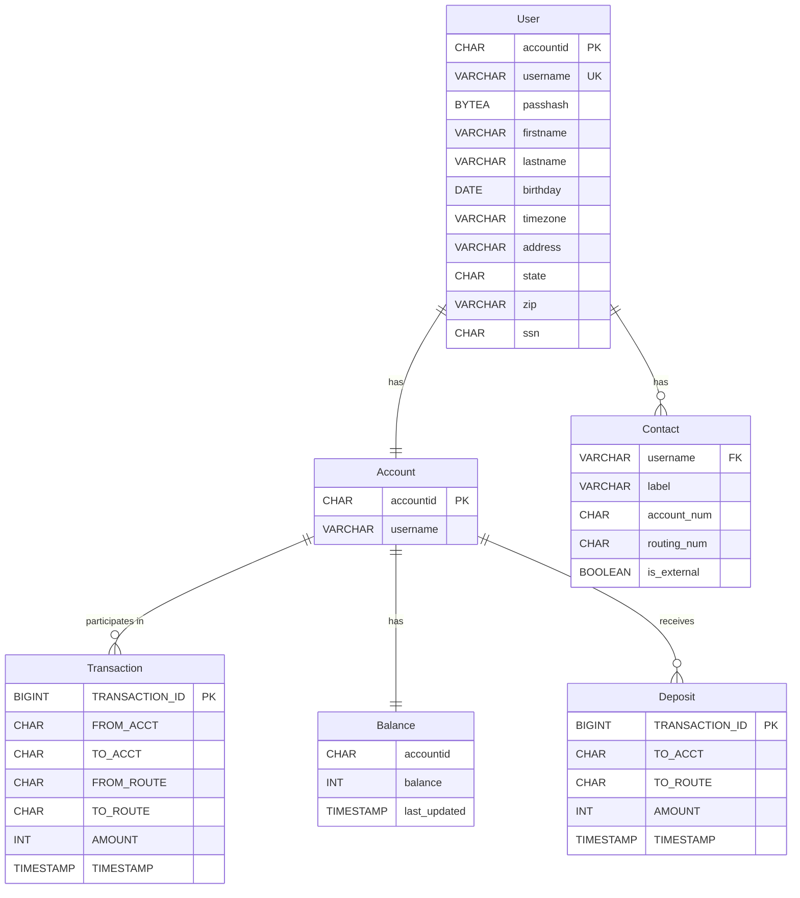
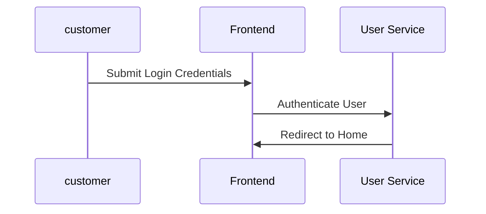
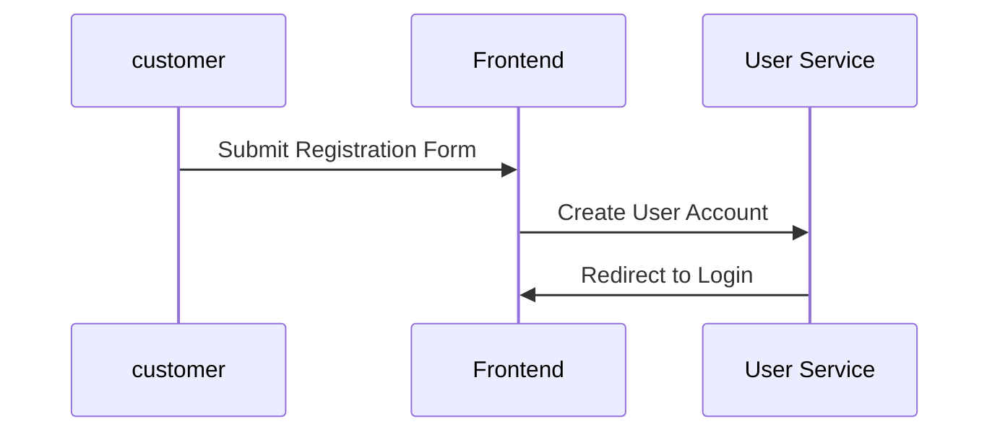
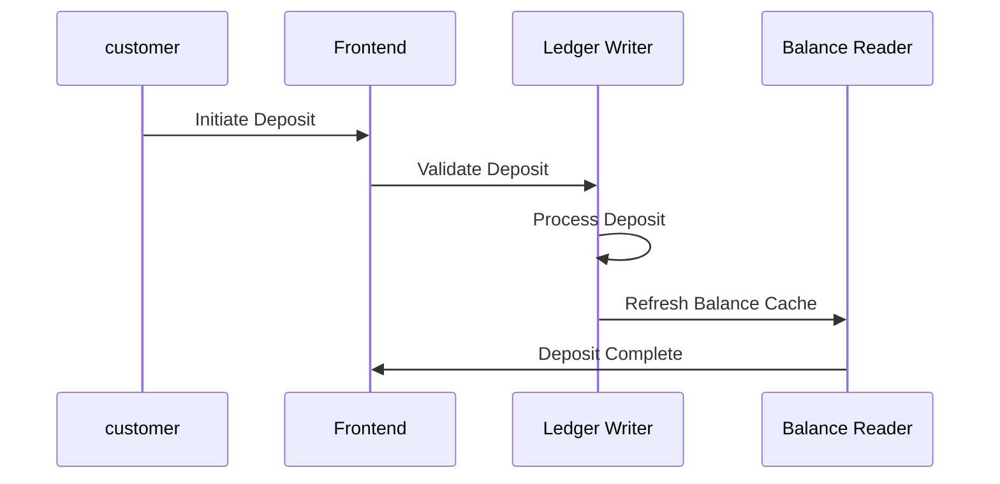
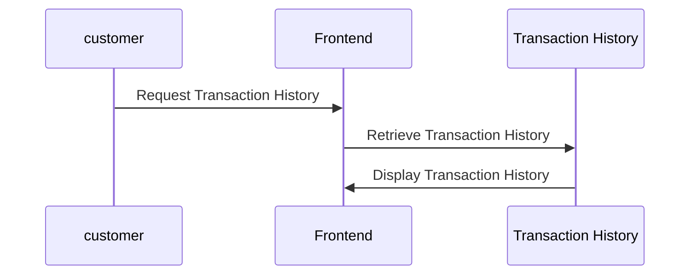
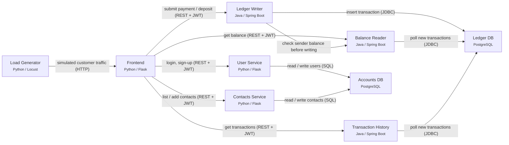

# Business Requirements Document — Bank of Anthos

> Reverse-engineered by Phoenix.ai from the system's own artifacts. Every requirement below is traced to the file and line it was read from; elements marked **inferred** were reasoned by the model and need confirmation.

| Item              | Value                                                                                                                                 |
| ----------------- | ------------------------------------------------------------------------------------------------------------------------------------- |
| Source            | https://github.com/GoogleCloudPlatform/bank-of-anthos @ `db35fea9fd09`                                                                |
| Generated         | Thu, 12 Nov 2026 07:33:45 GMT (z.ai + curated, glm-4.5-flash + hand-written (curated))                                                |
| Evidence read     | 75 files, 0 screenshots, 114 log events, 50 telemetry signals                                                                         |
| Extracted         | 4 domains · 6 entities · 12 activities · 5 flows · 4 personas · 5 journeys · 12 reports · 12 capabilities · 9 epics · 24 user stories |
| Confidence legend | high ≥ 80% · medium ≥ 60% · low < 60% · inferred = no direct evidence                                                                 |

## Contents

1. [Executive summary](#1-executive-summary)
2. [Business context, objectives & scope](#2-business-context-objectives--scope)
3. [Module coverage](#3-module-coverage)
4. [Business domains](#4-business-domains)
5. [Domain model](#5-domain-model)
6. [Actions & activities](#6-actions--activities)
7. [Execution & business flows](#7-execution--business-flows)
8. [Personas & user journeys](#8-personas--user-journeys)
9. [Reports](#9-reports)
10. [Capabilities, epics & user stories](#10-capabilities-epics--user-stories)
11. [Business rules](#11-business-rules)
12. [Architecture, integrations & NFRs](#12-architecture-integrations--nfrs)
13. [Gaps, risks, assumptions & open questions](#13-gaps-risks-assumptions--open-questions)
14. [Glossary](#14-glossary)

## 1. Executive summary

Bank of Anthos is a modern microservices-based digital banking platform that provides core retail banking services including user authentication, account management, payment processing, and transaction history. The system enables customers to create accounts, send payments to both internal and external accounts, make deposits, and view their transaction history through a web interface. The platform is built using a combination of Python/Flask and Java/Spring Boot services deployed on Kubernetes with PostgreSQL databases, and includes monitoring capabilities through Google Cloud services.

## 2. Business context, objectives & scope

Bank of Anthos serves as a demonstration of enterprise application modernization using Google Cloud products and Kubernetes microservices architecture. It provides a simplified banking experience for retail customers while showcasing how traditional banking applications can be transformed into cloud-native, scalable systems.

**Objectives**

- Provide a secure and user-friendly digital banking experience for retail customers
- Enable core banking operations including account management, payments, and deposits
- Demonstrate modern microservices architecture with proper separation of concerns
- Implement robust security measures including authentication and transaction validation
- Provide operational monitoring and observability for system administrators

**In scope**

- User registration and authentication with JWT-based security
- Account creation and management with personal information storage
- Payment processing between internal and external accounts
- Deposit processing from external accounts
- Transaction history and balance tracking
- Contact management for payment recipients
- Web-based user interface for all banking operations
- Operational monitoring and metrics collection

**Out of scope / not present in the system**

- Debit/credit card issuing and management
- Loan origination and servicing
- Multi-factor authentication implementation
- Fraud detection and prevention systems
- Regulatory compliance reporting
- Advanced risk management capabilities
- Mobile application support
- Formal disaster recovery and business continuity
- Real-time interbank network integration
- Advanced account types (checking/savings differentiation)

**Stakeholders**

| Stakeholder        | Interest                                                                                                   |
| ------------------ | ---------------------------------------------------------------------------------------------------------- |
| Retail Customer    | Secure access to banking services, ability to manage accounts, send payments, and view transaction history |
| System Operator    | System health monitoring, performance metrics, and operational maintenance                                 |
| System Engineer    | Application maintenance, security implementation, and feature development                                  |
| Compliance Officer | Regulatory compliance and audit trail capabilities                                                         |
| Fraud Analyst      | Transaction monitoring and fraud detection capabilities                                                    |

### Traceability to the initial BRD

Each requirement in the initial BRD (`inputs/bank-of-anthos/initial-brd.md`, "Retail Digital Banking — Initial BRD") checked against the evidence.

| ID    | Initial requirement                                                                               | Module                | Status          | Finding                                                                           | Evidence                                                                                                                                             |
| ----- | ------------------------------------------------------------------------------------------------- | --------------------- | --------------- | --------------------------------------------------------------------------------- | ---------------------------------------------------------------------------------------------------------------------------------------------------- |
| IN-01 | A customer can sign up online with their name, date of birth, address and a username and password | Accounts              | Confirmed       | System implements user registration with all required personal information fields | `src/accounts/userservice/userservice.py`, `src/accounts/accounts-db/initdb/0-accounts-schema.sql`                                                   |
| IN-02 | Each customer gets a bank account number immediately after sign-up                                | Accounts              | Confirmed       | System generates account numbers during user creation                             | `src/accounts/accounts-db/initdb/0-accounts-schema.sql`                                                                                              |
| IN-03 | A customer can hold both a checking and a savings account                                         | Accounts              | Not implemented | System does not differentiate between account types                               | `src/accounts/accounts-db/initdb/0-accounts-schema.sql`                                                                                              |
| IN-04 | A customer can see their current balance on the home page                                         | Accounts              | Confirmed       | System displays current balance on the home dashboard                             | `src/frontend/templates/index.html`, `src/ledger/balancereader/src/main/java/anthos/samples/bankofanthos/balancereader/BalanceReaderController.java` |
| IN-05 | A customer can save payees (contacts) to pay them again quickly                                   | Accounts              | Confirmed       | System implements contact management for payment recipients                       | `src/accounts/contacts/contacts.py`, `src/accounts/accounts-db/initdb/0-accounts-schema.sql`                                                         |
| IN-06 | A customer can send money to another customer of the bank                                         | Payments and Transfer | Confirmed       | System implements payment processing between internal accounts                    | `src/ledger/ledgerwriter/src/main/java/anthos/samples/bankofanthos/ledgerwriter/LedgerWriterController.java`                                         |
| IN-07 | A customer can send money to an account at another bank using its routing number                  | Payments and Transfer | Confirmed       | System supports external payments with routing number validation                  | `src/accounts/contacts/contacts.py`, `src/ledger/ledgerwriter/src/main/java/anthos/samples/bankofanthos/ledgerwriter/TransactionValidator.java`      |
| IN-08 | Customers may overdraw their account by up to $500                                                | Payments and Transfer | Not implemented | System prevents overdrafts without implementing overdraft protection              | `src/ledger/ledgerwriter/src/main/java/anthos/samples/bankofanthos/ledgerwriter/LedgerWriterController.java`                                         |
| IN-09 | The same payment must never be posted twice if the customer clicks submit again                   | Payments and Transfer | Confirmed       | System prevents duplicate transactions using UUID caching                         | `src/ledger/ledgerwriter/src/main/java/anthos/samples/bankofanthos/ledgerwriter/LedgerWriterController.java`                                         |
| IN-10 | A customer can see the history of their transactions                                              | Payments and Transfer | Confirmed       | System provides transaction history viewing capability                            | `src/ledger/transactionhistory/src/main/java/anthos/samples/bankofanthos/transactionhistory/TransactionHistoryController.java`                       |
| IN-11 | A customer can deposit money from an account at another bank                                      | Deposits              | Confirmed       | System implements deposit processing from external accounts                       | `src/ledger/ledgerwriter/src/main/java/anthos/samples/bankofanthos/ledgerwriter/LedgerWriterController.java`                                         |
| IN-12 | A customer can request a debit card and freeze it from the app                                    | Cards                 | Not implemented | System has no card issuing or management functionality                            | —                                                                                                                                                    |
| IN-13 | A customer can apply for a personal loan online and see the decision                              | Loans                 | Not implemented | System has no loan origination or decisioning capabilities                        | —                                                                                                                                                    |
| IN-14 | Customers must log in with a one-time code (two-factor authentication)                            | Overview              | Not implemented | System only implements username/password authentication without MFA               | `src/accounts/userservice/userservice.py`                                                                                                            |
| IN-15 | A session should end after 15 minutes of inactivity                                               | Overview              | Partially met   | System has JWT token expiration but it's set to 1 hour, not 15 minutes            | `src/accounts/userservice/userservice.py`                                                                                                            |
| IN-16 | Operations can see the health of each service and trace a slow request                            | Overview              | Confirmed       | System provides monitoring dashboard and distributed tracing capabilities         | `extras/metrics-dashboard/README.md`, `src/accounts/contacts/contacts.py`                                                                            |
| IN-17 | Customers receive a monthly statement                                                             | Accounts              | Not implemented | System has no statement generation or delivery functionality                      | —                                                                                                                                                    |

## 3. Module coverage

| Module                | Coverage | Summary                                                                                            | Activities | Capabilities | Stories |
| --------------------- | -------- | -------------------------------------------------------------------------------------------------- | ---------- | ------------ | ------- |
| Overview              | full     | Implements identity, login/sign-up, sessions, security, observability, and shared services         | 2          | 1            | 2       |
| Accounts              | partial  | Implements customer and bank-account lifecycle, profile, balances, and contacts/payees             | 4          | 3            | 2       |
| Payments and Transfer | partial  | Implements sending money between accounts, external transfers, validation, and transaction history | 5          | 2            | 3       |
| Deposits              | partial  | Implements deposits from external accounts and crediting balances                                  | 1          | 1            | 2       |
| Cards                 | none     | No debit/credit card issuing, controls, or authorizations implemented                              | 0          | 3            | 9       |
| Loans                 | none     | No loan origination, servicing, repayments, or credit decisioning implemented                      | 0          | 2            | 6       |

## 4. Business domains

| Domain              | Description                                              | Modules               | Owning services                                    | Confidence |
| ------------------- | -------------------------------------------------------- | --------------------- | -------------------------------------------------- | ---------- |
| Identity Management | Manages user authentication, authorization, and security | Overview              | User Service                                       | high (90%) |
| Account Management  | Manages customer accounts and related information        | Accounts              | User Service, Contacts Service                     | high (90%) |
| Payments            | Handles money transfers between accounts                 | Payments and Transfer | Ledger Writer, Balance Reader, Transaction History | high (90%) |
| Deposits            | Handles money coming into accounts from external sources | Deposits              | Ledger Writer, Contacts Service                    | high (90%) |

### Identity Management

Manages user authentication, authorization, and security

**Responsibilities**

- User authentication
- Session management
- Security enforcement

**Aggregates:** User (User)

### Account Management

Manages customer accounts and related information

**Responsibilities**

- Account creation
- Account maintenance
- Profile management

**Aggregates:** Account (Account); Contact (Contact)

### Payments

Handles money transfers between accounts

**Responsibilities**

- Payment processing
- Transfer validation
- Transaction history

**Aggregates:** Transaction (Transaction); Balance (Balance)

### Deposits

Handles money coming into accounts from external sources

**Responsibilities**

- Deposit processing
- External account validation

**Aggregates:** Deposit (Deposit)

## 5. Domain model

### User

_Identity Management · PostgreSQL accounts-db.users · confidence high (90%) · source `src/accounts/accounts-db/initdb/0-accounts-schema.sql`_

Bank customer with authentication credentials

| Attribute | Type        | Key    | Required | Meaning                                |
| --------- | ----------- | ------ | -------- | -------------------------------------- |
| accountid | CHAR(10)    | pk     | yes      | Unique identifier for the user account |
| username  | VARCHAR(64) | unique | yes      | Unique username for login              |
| passhash  | BYTEA       |        | yes      | Hashed password for authentication     |
| firstname | VARCHAR(64) |        | yes      | User's first name                      |
| lastname  | VARCHAR(64) |        | yes      | User's last name                       |
| birthday  | DATE        |        | yes      | User's date of birth                   |
| timezone  | VARCHAR(8)  |        | yes      | User's timezone setting                |
| address   | VARCHAR(64) |        | yes      | User's address                         |
| state     | CHAR(2)     |        | yes      | User's state abbreviation              |
| zip       | VARCHAR(5)  |        | yes      | User's ZIP code                        |
| ssn       | CHAR(11)    |        | yes      | User's Social Security Number          |

### Account

_Account Management · PostgreSQL accounts-db.users · confidence high (90%) · source `src/accounts/accounts-db/initdb/0-accounts-schema.sql`_

Bank account with balance and transaction history

| Attribute | Type        | Key | Required | Meaning                                |
| --------- | ----------- | --- | -------- | -------------------------------------- |
| accountid | CHAR(10)    | pk  | yes      | Unique identifier for the bank account |
| username  | VARCHAR(64) |     | yes      | Username associated with the account   |

### Contact

_Account Management · PostgreSQL accounts-db.contacts · confidence high (90%) · source `src/accounts/accounts-db/initdb/0-accounts-schema.sql`_

Payment recipient or external account for deposits

| Attribute   | Type         | Key | Required | Meaning                              |
| ----------- | ------------ | --- | -------- | ------------------------------------ |
| username    | VARCHAR(64)  | fk  | yes      | Username who owns this contact       |
| label       | VARCHAR(128) |     | yes      | User-defined label for the contact   |
| account_num | CHAR(10)     |     | yes      | Account number of the contact        |
| routing_num | CHAR(9)      |     | yes      | Routing number of the contact's bank |
| is_external | BOOLEAN      |     | yes      | Whether this is an external account  |

### Transaction

_Payments · PostgreSQL ledger-db.TRANSACTIONS · confidence high (90%) · source `src/ledger/ledger-db/initdb/0_init_tables.sql`_

Record of money movement between accounts

| Attribute      | Type      | Key | Required | Meaning                                 |
| -------------- | --------- | --- | -------- | --------------------------------------- |
| TRANSACTION_ID | BIGINT    | pk  | yes      | Unique identifier for the transaction   |
| FROM_ACCT      | CHAR(10)  |     | yes      | Account number sending the money        |
| TO_ACCT        | CHAR(10)  |     | yes      | Account number receiving the money      |
| FROM_ROUTE     | CHAR(9)   |     | yes      | Routing number of the sending account   |
| TO_ROUTE       | CHAR(9)   |     | yes      | Routing number of the receiving account |
| AMOUNT         | INT       |     | yes      | Amount of money transferred in cents    |
| TIMESTAMP      | TIMESTAMP |     | yes      | When the transaction occurred           |

### Balance

_Payments · PostgreSQL ledger-db (cached in memory) · confidence high (90%) · source `src/ledger/balancereader/src/main/java/anthos/samples/bankofanthos/balancereader/BalanceReaderController.java`_

Current balance of an account

| Attribute    | Type      | Key | Required | Meaning                           |
| ------------ | --------- | --- | -------- | --------------------------------- |
| accountid    | CHAR(10)  |     | yes      | Account identifier                |
| balance      | INT       |     | yes      | Current balance in cents          |
| last_updated | TIMESTAMP |     | yes      | When the balance was last updated |

### Deposit

_Deposits · PostgreSQL ledger-db.TRANSACTIONS · confidence high (90%) · source `src/ledger/ledger-db/initdb/0_init_tables.sql`, `src/ledger/ledgerwriter/src/main/java/anthos/samples/bankofanthos/ledgerwriter/LedgerWriterController.java`_

Money coming into an account from an external source

| Attribute      | Type      | Key | Required | Meaning                                       |
| -------------- | --------- | --- | -------- | --------------------------------------------- |
| TRANSACTION_ID | BIGINT    | pk  | yes      | Unique identifier for the deposit transaction |
| TO_ACCT        | CHAR(10)  |     | yes      | Account number receiving the deposit          |
| TO_ROUTE       | CHAR(9)   |     | yes      | Routing number of the receiving account       |
| AMOUNT         | INT       |     | yes      | Amount of money deposited in cents            |
| TIMESTAMP      | TIMESTAMP |     | yes      | When the deposit occurred                     |

**Relationships**

| From    | Relationship    | To          | Cardinality |
| ------- | --------------- | ----------- | ----------- |
| User    | has             | Account     | 1:1         |
| User    | has             | Contact     | 1:N         |
| Account | participates in | Transaction | 1:N         |
| Account | has             | Balance     | 1:1         |
| Account | receives        | Deposit     | 1:N         |

## 6. Actions & activities

### Overview

| Activity                                                                                    | Actor    | Trigger                        | Inputs → Outputs               | Business rules                                                                                               | Endpoint       | Source                                                                |
| ------------------------------------------------------------------------------------------- | -------- | ------------------------------ | ------------------------------ | ------------------------------------------------------------------------------------------------------------ | -------------- | --------------------------------------------------------------------- |
| **Authenticate user** — User provides username and password to authenticate with the system | customer | User submits login credentials | username, password → JWT token | Username must be 2-15 alphanumeric characters or underscores; Password must be hashed using bcrypt with salt | `POST /login`  | `src/accounts/userservice/userservice.py`, `src/frontend/frontend.py` |
| **Logout user** — User ends their current session                                           | customer | User requests logout           | — → Session ended              | JWT token is invalidated; User must be authenticated                                                         | `POST /logout` | `src/frontend/frontend.py`                                            |

### Accounts

| Activity                                                                                        | Actor    | Trigger                           | Inputs → Outputs                                                                                             | Business rules                                                                                                                        | Endpoint                    | Source                                                                                                                                      |
| ----------------------------------------------------------------------------------------------- | -------- | --------------------------------- | ------------------------------------------------------------------------------------------------------------ | ------------------------------------------------------------------------------------------------------------------------------------- | --------------------------- | ------------------------------------------------------------------------------------------------------------------------------------------- |
| **Create user account** — New user creates an account with personal information and credentials | customer | User submits registration form    | username, password, firstname, lastname, birthday, timezone, address, state, zip, ssn → User account created | Username must be 2-15 alphanumeric characters or underscores; Password must be hashed using bcrypt with salt; All fields are required | `POST /users`               | `src/accounts/userservice/userservice.py`, `src/frontend/frontend.py`                                                                       |
| **View account balance** — User retrieves current balance for their account                     | customer | User requests balance information | accountid → Current balance amount                                                                           | User must be authenticated; Balance is cached for efficiency                                                                          | `GET /balances/<accountid>` | `src/ledger/balancereader/src/main/java/anthos/samples/bankofanthos/balancereader/BalanceReaderController.java`, `src/frontend/frontend.py` |
| **Add payment contact** — User adds a contact for future payments or deposits                   | customer | User adds a new contact           | username, label, account_num, routing_num, is_external → Contact added successfully                          | Account numbers must be 10 digits; Routing numbers must be 9 digits; External accounts cannot use the local bank routing number       | `POST /contacts/<username>` | `src/accounts/contacts/contacts.py`, `src/frontend/frontend.py`                                                                             |
| **Retrieve contacts** — User retrieves their saved contacts for payments and deposits           | customer | User requests contacts list       | username → List of contacts                                                                                  | User must be authenticated                                                                                                            | `GET /contacts/<username>`  | `src/accounts/contacts/contacts.py`, `src/frontend/frontend.py`                                                                             |

### Payments and Transfer

| Activity                                                                                     | Actor    | Trigger                                     | Inputs → Outputs                                                            | Business rules                                                                                                                                                                                   | Endpoint                        | Source                                                                                                                                                     |
| -------------------------------------------------------------------------------------------- | -------- | ------------------------------------------- | --------------------------------------------------------------------------- | ------------------------------------------------------------------------------------------------------------------------------------------------------------------------------------------------ | ------------------------------- | ---------------------------------------------------------------------------------------------------------------------------------------------------------- |
| **Send payment** — User transfers money to another account                                   | customer | User initiates a payment to another account | from_acct, to_acct, from_route, to_route, amount → Transaction confirmation | Amount must be positive; User cannot send payments to themselves; User cannot send payments exceeding their account balance; Duplicate transactions are prevented using UUID caching             | `POST /transactions`            | `src/ledger/ledgerwriter/src/main/java/anthos/samples/bankofanthos/ledgerwriter/LedgerWriterController.java`, `src/frontend/frontend.py`                   |
| **View transaction history** — User retrieves historical transactions for their account      | customer | User requests transaction history           | accountid → List of transactions                                            | User must be authenticated; Transaction history is cached for efficiency                                                                                                                         | `GET /transactions/<accountid>` | `src/ledger/transactionhistory/src/main/java/anthos/samples/bankofanthos/transactionhistory/TransactionHistoryController.java`, `src/frontend/frontend.py` |
| **Validate transaction** — System validates a transaction before processing                  | system   | Transaction submission                      | Transaction details → Validation result                                     | Amount must be positive; User cannot send payments to themselves; User cannot send payments exceeding their account balance; Account numbers must be 10 digits; Routing numbers must be 9 digits | —                               | `src/ledger/ledgerwriter/src/main/java/anthos/samples/bankofanthos/ledgerwriter/TransactionValidator.java`                                                 |
| **Refresh balance cache** — System updates the cached balance for an account                 | system   | Balance update needed                       | accountid → Updated balance                                                 | Balance is cached for efficiency; Cache is refreshed periodically                                                                                                                                | —                               | `src/ledger/balancereader/src/main/java/anthos/samples/bankofanthos/balancereader/BalanceReaderController.java`                                            |
| **Refresh transaction cache** — System updates the cached transaction history for an account | system   | Transaction history update needed           | accountid → Updated transaction history                                     | Transaction history is cached for efficiency; Cache is refreshed periodically                                                                                                                    | —                               | `src/ledger/transactionhistory/src/main/java/anthos/samples/bankofanthos/transactionhistory/TransactionHistoryController.java`                             |

### Deposits

| Activity                                                                          | Actor    | Trigger                                        | Inputs → Outputs                                 | Business rules                                                                      | Endpoint        | Source                                                                                                                                   |
| --------------------------------------------------------------------------------- | -------- | ---------------------------------------------- | ------------------------------------------------ | ----------------------------------------------------------------------------------- | --------------- | ---------------------------------------------------------------------------------------------------------------------------------------- |
| **Make deposit** — User deposits money into their account from an external source | customer | User initiates a deposit from external account | to_acct, to_route, amount → Deposit confirmation | Amount must be positive; External accounts cannot use the local bank routing number | `POST /deposit` | `src/ledger/ledgerwriter/src/main/java/anthos/samples/bankofanthos/ledgerwriter/LedgerWriterController.java`, `src/frontend/frontend.py` |

## 7. Execution & business flows

### User Login Flow

_Overview · actor: customer · starts at: scr-login · confidence high (90%)_

End-to-end sequence for user authentication

1. **Submit Login Credentials** _(Frontend)_ — User enters username and password on login screen
2. **Authenticate User** _(User Service)_ — User service validates credentials and generates JWT token Reads: User.
3. **Redirect to Home** _(Frontend)_ — Frontend redirects authenticated user to home dashboard

### User Signup Flow

_Accounts · actor: customer · starts at: scr-signup · confidence high (90%)_

End-to-end sequence for new user registration

1. **Submit Registration Form** _(Frontend)_ — User enters personal information and credentials on signup screen
2. **Create User Account** _(User Service)_ — User service creates new user account in database Writes: User.
3. **Redirect to Login** _(Frontend)_ — Frontend redirects newly registered user to login screen

### Send Payment Flow

_Payments and Transfer · actor: customer · starts at: scr-home · confidence high (90%)_

End-to-end sequence for transferring money between accounts

1. **Initiate Payment** _(Frontend)_ — User submits payment request through frontend Reads: Contact.
2. **Validate Payment** _(Ledger Writer)_ — Ledger writer service validates payment details and checks balance Reads: Balance, Transaction.
3. **Process Payment** _(Ledger Writer)_ — Ledger writer service processes the transaction and updates ledger Writes: Transaction, Balance.
4. **Refresh Balance Cache** _(Balance Reader)_ — Balance reader service updates cached balance Reads: Balance. Writes: Balance.
5. **Payment Complete** _(Frontend)_ — Frontend displays payment confirmation to user Reads: Balance.

### Make Deposit Flow

_Deposits · actor: customer · starts at: scr-home · confidence high (90%)_

End-to-end sequence for depositing money into an account

1. **Initiate Deposit** _(Frontend)_ — User submits deposit request through frontend Reads: Contact.
2. **Validate Deposit** _(Ledger Writer)_ — Ledger writer service validates deposit details Reads: Contact.
3. **Process Deposit** _(Ledger Writer)_ — Ledger writer service processes the deposit and updates ledger Writes: Deposit, Balance.
4. **Refresh Balance Cache** _(Balance Reader)_ — Balance reader service updates cached balance Reads: Balance. Writes: Balance.
5. **Deposit Complete** _(Frontend)_ — Frontend displays deposit confirmation to user Reads: Balance.

### View Transaction History Flow

_Payments and Transfer · actor: customer · starts at: scr-home · confidence high (90%)_

End-to-end sequence for retrieving transaction history

1. **Request Transaction History** _(Frontend)_ — User requests transaction history through frontend
2. **Retrieve Transaction History** _(Transaction History)_ — Transaction history service retrieves cached history Reads: Transaction.
3. **Display Transaction History** _(Frontend)_ — Frontend displays transaction history to user Reads: Transaction.

## 8. Personas & user journeys

### Bank Customer — Individual banking customer

**Goals**

- Access account information and balances
- Send payments to other accounts
- Make deposits from external accounts
- View transaction history
- Manage payment contacts

**Pain points**

- Limited authentication options (no multi-factor authentication)
- No fraud detection system for suspicious transactions
- No mobile app access
- Limited self-service options for account issues

#### Journey: Customer Onboarding Journey

_Accounts · realised by: User Signup Flow_

New customer journey from registration to first transaction

| Stage    | Action                                   | Touchpoint                 | Pain point                                   |
| -------- | ---------------------------------------- | -------------------------- | -------------------------------------------- |
| Discover | Research banking services                | Web browser                | Limited information about available services |
| Onboard  | Create account with personal information | Signup screen              | Required SSN may raise privacy concerns      |
| Transact | Make first deposit or payment            | Home dashboard             | No guidance on first transaction process     |
| Review   | Verify account setup and transactions    | Transaction history screen | Limited account statement customization      |

#### Journey: Customer Payment Journey

_Payments and Transfer · realised by: Send Payment Flow_

Customer journey for sending payments to other accounts

| Stage    | Action                                     | Touchpoint          | Pain point                                           |
| -------- | ------------------------------------------ | ------------------- | ---------------------------------------------------- |
| Discover | Locate payment recipient information       | Contacts list       | Manual entry required for new contacts               |
| Transact | Initiate payment with amount and recipient | Payment form        | No real-time balance validation during input         |
| Review   | Confirm payment details and submit         | Confirmation screen | Limited options to modify or cancel after submission |
| Review   | Verify payment completion and receipt      | Transaction history | No immediate notification of payment status          |

### System Operator — IT operations staff maintaining the banking system

**Goals**

- Monitor system health and performance
- Respond to service alerts
- Manage application deployments
- Troubleshoot technical issues

**Pain points**

- Limited monitoring capabilities beyond basic metrics
- No automated scaling based on demand
- No comprehensive incident response procedures
- Limited visibility into transaction processing

#### Journey: Operator Monitoring Journey

_Overview · realised by: —_

System operator journey for monitoring application health

| Stage    | Action                                      | Touchpoint        | Pain point                                     |
| -------- | ------------------------------------------- | ----------------- | ---------------------------------------------- |
| Discover | Access monitoring dashboard                 | Metrics dashboard | Limited metrics beyond basic health indicators |
| Review   | Check system health and performance metrics | Monitoring tools  | No automated alerting for critical issues      |
| Review   | Investigate service alerts and anomalies    | Logging systems   | Limited correlation between logs and metrics   |
| Review   | Document and escalate issues                | Ticketing system  | No formal incident response procedures         |

### System Engineer — Development and maintenance staff

**Goals**

- Maintain and update banking application code
- Ensure system security and compliance
- Optimize performance and scalability
- Implement new features and services

**Pain points**

- No formal architecture documentation
- Limited security testing evidence
- No formal change management process
- Missing compliance documentation

#### Journey: Engineer Maintenance Journey

_Overview · realised by: —_

System engineer journey for maintaining and updating the banking application

| Stage    | Action                                       | Touchpoint          | Pain point                                 |
| -------- | -------------------------------------------- | ------------------- | ------------------------------------------ |
| Discover | Review system architecture and dependencies  | Documentation       | No formal architecture documentation       |
| Review   | Analyze system performance and logs          | Monitoring tools    | Limited performance profiling capabilities |
| Transact | Deploy updates and configuration changes     | Deployment tools    | No formal change management process        |
| Review   | Verify deployment and validate functionality | Testing environment | No comprehensive testing framework         |

### Load Generator — Testing service simulating user activity

**Goals**

- Simulate realistic user transaction patterns
- Test system performance under load
- Identify potential bottlenecks
- Validate system reliability

**Pain points**

- Limited variability in transaction patterns
- No sophisticated fraud simulation
- No integration with production monitoring
- Limited testing scenarios

#### Journey: Load Testing Journey

_Overview · realised by: —_

Load generator journey for simulating user activity and testing system performance

| Stage    | Action                                          | Touchpoint               | Pain point                                                    |
| -------- | ----------------------------------------------- | ------------------------ | ------------------------------------------------------------- |
| Discover | Configure test scenarios and parameters         | Load generator interface | Limited variability in test scenarios                         |
| Transact | Execute load tests against banking services     | Testing infrastructure   | No integration with production monitoring                     |
| Review   | Analyze test results and performance metrics    | Reporting tools          | Limited correlation between load patterns and system behavior |
| Review   | Identify bottlenecks and recommend improvements | Analysis reports         | No automated optimization suggestions                         |

## 9. Reports

| Report                        | Module                | Status               | Purpose                                                 | Audience                        | Key fields                                                                                                                       | Frequency | Source                                                                                                                         |
| ----------------------------- | --------------------- | -------------------- | ------------------------------------------------------- | ------------------------------- | -------------------------------------------------------------------------------------------------------------------------------- | --------- | ------------------------------------------------------------------------------------------------------------------------------ |
| Account Statement             | Accounts              | Exists today         | Provide detailed account activity for a specific period | customer                        | Account number, Opening balance, Closing balance, Transactions list, Transaction dates, Transaction amounts, Transaction parties | monthly   | `src/ledger/transactionhistory/src/main/java/anthos/samples/bankofanthos/transactionhistory/TransactionHistoryController.java` |
| Balance Summary               | Accounts              | Exists today         | Show current balance for customer accounts              | customer                        | Account number, Current balance, Last updated timestamp                                                                          | on demand | `src/ledger/balancereader/src/main/java/anthos/samples/bankofanthos/balancereader/BalanceReaderController.java`                |
| Transaction History           | Payments and Transfer | Exists today         | Show historical transactions for customer accounts      | customer                        | Transaction ID, From account, To account, Amount, Timestamp, Status                                                              | on demand | `src/ledger/transactionhistory/src/main/java/anthos/samples/bankofanthos/transactionhistory/TransactionHistoryController.java` |
| Operational Metrics           | Overview              | Exists today         | Monitor system health and performance                   | operators, administrators       | Transaction volume, Response times, Error rates, System health status                                                            | real-time | `extras/metrics-dashboard/README.md`, `extras/prometheus/README.md`                                                            |
| User Activity Report          | Overview              | Exists today         | Track user login and activity patterns                  | security team, administrators   | User ID, Login timestamps, Failed login attempts, IP addresses, Actions performed                                                | daily     | `src/accounts/userservice/userservice.py`                                                                                      |
| Fraud Detection Report        | Cards                 | Required — not built | Identify potentially fraudulent transactions            | fraud analysts, security team   | Suspicious transactions, Unusual patterns, Risk scores, Recommended actions                                                      | real-time | _inferred_                                                                                                                     |
| Regulatory Compliance Report  | Cards                 | Required — not built | Ensure adherence to banking regulations                 | compliance officers, regulators | Compliance status, Audit trails, Policy violations, Remediation actions                                                          | monthly   | _inferred_                                                                                                                     |
| Account Reconciliation Report | Cards                 | Required — not built | Verify account balances match between systems           | accountants, auditors           | Account numbers, System balances, Ledger balances, Differences, Adjustments                                                      | daily     | _inferred_                                                                                                                     |
| Card Activity Report          | Cards                 | Required — not built | Monitor debit/credit card transactions                  | card services, fraud team       | Card numbers, Transaction amounts, Merchant categories, Geographic locations, Authorization status                               | daily     | _inferred_                                                                                                                     |
| Loan Performance Report       | Loans                 | Required — not built | Track loan portfolio performance                        | loan officers, risk managers    | Loan IDs, Outstanding balances, Payment status, Delinquency rates, Collateral values                                             | monthly   | _inferred_                                                                                                                     |
| Risk Assessment Report        | Loans                 | Required — not built | Evaluate credit risk exposure                           | risk managers, executives       | Risk scores, Exposure amounts, Concentration metrics, Mitigation strategies                                                      | quarterly | _inferred_                                                                                                                     |
| Capital Adequacy Report       | Loans                 | Required — not built | Ensure sufficient capital reserves                      | executives, regulators          | Capital ratios, Risk-weighted assets, Tier 1 capital, Regulatory requirements                                                    | quarterly | _inferred_                                                                                                                     |

## 10. Capabilities, epics & user stories

### Overview

_Coverage: full. Implements identity, login/sign-up, sessions, security, observability, and shared services_

**Capabilities**

| Capability          | Status      | Description                                              | Realised by                    |
| ------------------- | ----------- | -------------------------------------------------------- | ------------------------------ |
| User Authentication | implemented | Ability to authenticate users with username and password | Authenticate user, Logout user |

#### Epic: Security Enhancement

Improve security measures across the banking system

##### Feature: Multi-Factor Authentication

Implement multi-factor authentication for user login

- **story-001 · Login with MFA** _(must, inferred (70%))_  
  As a **bank customer**, I want **to use multi-factor authentication when logging in**, so that **to enhance the security of my account**.
  - [ ] Given I have enabled MFA on my account, when I enter my username and password, then I should be prompted for a second authentication factor
  - [ ] Given I have entered my second authentication factor, when it is correct, then I should be granted access to my account
  - [ ] Given I have entered an incorrect second authentication factor, when I attempt to login, then I should be denied access and notified of the failed attempt

##### Feature: Identity Management System

Implement a comprehensive identity management system

- **story-002 · Integrate with Identity Provider** _(should, inferred (70%))_  
  As a **system administrator**, I want **to integrate with an external identity management system**, so that **to centralize user authentication and authorization**.
  - [ ] Given I am a system administrator, when I configure the identity provider integration, then the system should be able to authenticate users through the external provider
  - [ ] Given I have configured identity provider integration, when a user logs in, then the system should validate their credentials against the external provider
  - [ ] Given a user is authenticated through the external provider, when they access the system, then their roles and permissions should be properly applied

### Accounts

_Coverage: partial. Implements customer and bank-account lifecycle, profile, balances, and contacts/payees_

**Capabilities**

| Capability         | Status      | Description                                                   | Realised by                                 |
| ------------------ | ----------- | ------------------------------------------------------------- | ------------------------------------------- |
| User Registration  | implemented | Ability to create new user accounts with personal information | Create user account                         |
| Account Management | implemented | Ability to manage customer accounts and related information   | Add payment contact, Retrieve contacts      |
| Balance Management | implemented | Ability to view and manage account balances                   | View account balance, Refresh balance cache |

#### Epic: Account Management

Enhance customer account management capabilities

##### Feature: User Profile Management

Ability for customers to manage their personal information

- **story-003 · Update Personal Information** _(should, high (90%))_  
  As a **bank customer**, I want **to update my personal information in the system**, so that **to keep my account details current and accurate**.
  - [ ] Given I am an authenticated customer, when I navigate to my profile settings, then I should see my current personal information
  - [ ] Given I have updated my personal information, when I save the changes, then the system should validate the input and update my profile
  - [ ] Given I have updated my information, when I view my profile again, then I should see the updated information

##### Feature: Contact Management

Ability to manage payment contacts and external accounts

- **story-004 · Manage Payment Contacts** _(should, high (90%))_  
  As a **bank customer**, I want **to add, edit, and delete payment contacts**, so that **to easily send payments to frequently used recipients**.
  - [ ] Given I am an authenticated customer, when I view my contacts, then I should see all my saved contacts
  - [ ] Given I want to add a new contact, when I enter the contact details and submit, then the contact should be saved and appear in my contacts list
  - [ ] Given I have an existing contact, when I choose to edit it, then I should be able to modify the contact details and save the changes
  - [ ] Given I have an existing contact, when I choose to delete it, then the contact should be removed from my contacts list

### Payments and Transfer

_Coverage: partial. Implements sending money between accounts, external transfers, validation, and transaction history_

**Capabilities**

| Capability          | Status      | Description                                | Realised by                                         |
| ------------------- | ----------- | ------------------------------------------ | --------------------------------------------------- |
| Payment Processing  | implemented | Ability to transfer money between accounts | Send payment, Validate transaction                  |
| Transaction History | implemented | Ability to view historical transactions    | View transaction history, Refresh transaction cache |

#### Epic: Payment Processing

Enhance payment processing capabilities

##### Feature: Payment Scheduling

Ability to schedule future payments

- **story-005 · Schedule Future Payment** _(could, inferred (70%))_  
  As a **bank customer**, I want **to schedule a payment for a future date**, so that **to ensure bills are paid on time without manual intervention**.
  - [ ] Given I am an authenticated customer, when I initiate a payment, then I should have the option to schedule it for a future date
  - [ ] Given I have selected a future date for payment, when I confirm the payment, then it should be scheduled and appear in my scheduled payments
  - [ ] Given I have a scheduled payment, when the payment date arrives, then the payment should be processed automatically
  - [ ] Given I have a scheduled payment, when I choose to cancel it, then the payment should be cancelled and removed from my scheduled payments

##### Feature: Enhanced Payment Validation

Improve validation of payment transactions

- **story-006 · Validate Payment Details** _(should, high (90%))_  
  As a **bank customer**, I want **to receive validation feedback when entering payment details**, so that **to catch errors before submitting a payment**.
  - [ ] Given I am entering payment details, when I input an invalid account number, then the system should display an error message
  - [ ] Given I am entering payment details, when I input an invalid routing number, then the system should display an error message
  - [ ] Given I am entering payment details, when I input an amount that exceeds my balance, then the system should display an error message
  - [ ] Given I am entering payment details, when I attempt to send a payment to myself, then the system should display an error message

##### Feature: Transaction History Management

Ability to view and manage transaction history

- **story-007 · View Transaction History** _(must, high (90%))_  
  As a **bank customer**, I want **to view my transaction history**, so that **to track my spending and verify transactions**.
  - [ ] Given I am an authenticated customer, when I navigate to my transaction history, then I should see a list of my transactions
  - [ ] Given I am viewing my transaction history, when I filter by date range, then I should only see transactions within that range
  - [ ] Given I am viewing my transaction history, when I search for a specific transaction, then I should be able to find it by amount or recipient
  - [ ] Given I am viewing my transaction history, when I click on a transaction, then I should see detailed information about that transaction

### Deposits

_Coverage: partial. Implements deposits from external accounts and crediting balances_

**Capabilities**

| Capability         | Status      | Description                                        | Realised by                        |
| ------------------ | ----------- | -------------------------------------------------- | ---------------------------------- |
| Deposit Processing | implemented | Ability to process deposits from external accounts | Make deposit, Validate transaction |

#### Epic: Deposit Processing

Enhance deposit processing capabilities

##### Feature: Deposit Verification

Ability to verify deposits from external accounts

- **story-008 · Verify External Deposit** _(must, high (90%))_  
  As a **bank customer**, I want **to verify that my external deposit has been processed**, so that **to ensure my funds are available in my account**.
  - [ ] Given I have made a deposit from an external account, when I check my transaction history, then I should see the deposit transaction
  - [ ] Given I have made a deposit from an external account, when I check my balance, then I should see the deposited amount reflected
  - [ ] Given I have made a deposit from an external account, when I view the deposit details, then I should see the source account and routing number
  - [ ] Given I have made a deposit from an external account, when the deposit is processed, then I should receive a confirmation notification

##### Feature: Deposit Scheduling

Ability to schedule recurring deposits

- **story-009 · Schedule Recurring Deposit** _(could, inferred (70%))_  
  As a **bank customer**, I want **to schedule recurring deposits from my external account**, so that **to regularly fund my account without manual intervention**.
  - [ ] Given I am an authenticated customer, when I navigate to deposit options, then I should have the option to schedule a recurring deposit
  - [ ] Given I have chosen to schedule a recurring deposit, when I set the frequency and amount, then the system should save my preferences
  - [ ] Given I have set up a recurring deposit, when the scheduled date arrives, then the deposit should be processed automatically
  - [ ] Given I have a recurring deposit, when I choose to modify it, then I should be able to update the frequency or amount

### Cards

_Coverage: none. No debit/credit card issuing, controls, or authorizations implemented_

**Capabilities**

| Capability            | Status | Description                                           | Realised by |
| --------------------- | ------ | ----------------------------------------------------- | ----------- |
| Card Issuing          | gap    | Ability to issue and manage debit/credit cards        | —           |
| Fraud Detection       | gap    | Ability to detect and prevent fraudulent transactions | —           |
| Regulatory Compliance | gap    | Ability to ensure adherence to banking regulations    | —           |

#### Epic: Card Services

Implement debit/credit card issuing and management

##### Feature: Card Issuance

Ability to issue new debit/credit cards to customers

- **story-010 · Issue New Card** _(must, inferred (70%))_  
  As a **bank customer**, I want **to request a new debit/credit card**, so that **I can make purchases using my bank account**.
  - [ ] Given I am an authenticated customer, when I request a new card, then the system should collect my card preferences
  - [ ] Given I have submitted my card request, when it is approved, then I should receive a confirmation with card details
  - [ ] Given I have received a new card, when I activate it, then it should be ready for use

##### Feature: Card Management

Ability to manage existing cards (activate, freeze, replace)

- **story-011 · Manage My Card** _(should, inferred (70%))_  
  As a **bank customer**, I want **to manage my existing cards**, so that **I can control access to my accounts**.
  - [ ] Given I am an authenticated customer with existing cards, when I view my cards, then I should see all my active and inactive cards
  - [ ] Given I have an active card, when I choose to freeze it, then the card should be immediately frozen and no transactions should be allowed
  - [ ] Given I have a frozen card, when I choose to unfreeze it, then the card should be reactivated and transactions should be allowed again

##### Feature: Card Activity Monitoring

Ability to monitor and report on card transactions

- **story-012 · Monitor Card Activity** _(should, inferred (70%))_  
  As a **bank customer**, I want **to view my card transaction history**, so that **I can track my spending and identify unauthorized transactions**.
  - [ ] Given I am an authenticated customer with a card, when I view my card activity, then I should see all transactions for that card
  - [ ] Given I have a transaction in my history, when I click on it, then I should see detailed information about the transaction
  - [ ] Given I suspect a fraudulent transaction, when I report it, then it should be flagged for investigation

#### Epic: Fraud Detection System

Implement comprehensive fraud detection and prevention

##### Feature: Real-time Transaction Monitoring

Ability to monitor transactions in real-time for suspicious activity

- **story-016 · Monitor Transactions in Real-time** _(must, inferred (70%))_  
  As a **fraud analyst**, I want **to monitor transactions in real-time for suspicious activity**, so that **I can detect and prevent fraudulent transactions**.
  - [ ] Given I am a fraud analyst, when I view the real-time monitoring dashboard, then I should see all current transactions being processed
  - [ ] Given a transaction matches suspicious patterns, when it is detected, then it should be flagged for review
  - [ ] Given a transaction is flagged as suspicious, when I investigate it, then I should have the option to approve, decline, or escalate the transaction

##### Feature: Pattern Detection

Ability to detect patterns of fraudulent behavior

- **story-017 · Detect Fraudulent Patterns** _(should, inferred (70%))_  
  As a **fraud analyst**, I want **to detect patterns of fraudulent behavior**, so that **I can identify organized fraud attempts**.
  - [ ] Given I am a fraud analyst, when I run a pattern detection analysis, then the system should identify any unusual patterns in transaction data
  - [ ] Given a pattern is identified, when I view the details, then I should see the specific transactions that make up the pattern
  - [ ] Given a pattern is confirmed as fraudulent, when I take action, then the system should be able to block similar future transactions

##### Feature: Fraud Reporting

Ability to generate reports on fraud detection activities

- **story-018 · Generate Fraud Reports** _(should, inferred (70%))_  
  As a **fraud analyst**, I want **to generate reports on fraud detection activities**, so that **I can track fraud trends and measure the effectiveness of prevention measures**.
  - [ ] Given I am a fraud analyst, when I request a fraud report, then I should be able to specify the time period and type of data to include
  - [ ] Given I have generated a report, when I view it, then it should include statistics on detected fraud, blocked transactions, and false positives
  - [ ] Given I have a report, when I export it, then it should be available in a standard format for further analysis

#### Epic: Regulatory Compliance

Ensure adherence to banking regulations and requirements

##### Feature: Compliance Monitoring

Ability to monitor compliance with banking regulations

- **story-019 · Monitor Regulatory Compliance** _(must, inferred (70%))_  
  As a **compliance officer**, I want **to monitor compliance with banking regulations**, so that **I can ensure the bank meets all regulatory requirements**.
  - [ ] Given I am a compliance officer, when I view the compliance dashboard, then I should see the status of all regulatory requirements
  - [ ] Given a regulation is not being met, when I view the details, then I should see specific areas of non-compliance
  - [ ] Given I have identified a compliance issue, when I assign it to a team, then it should be tracked until resolution

##### Feature: Audit Trails

Ability to maintain comprehensive audit trails for regulatory purposes

- **story-020 · Maintain Audit Trails** _(must, inferred (70%))_  
  As a **compliance officer**, I want **to maintain comprehensive audit trails**, so that **I can provide evidence of compliance during audits**.
  - [ ] Given I am a compliance officer, when I request an audit trail, then I should be able to specify the time period and type of activities to include
  - [ ] Given I have generated an audit trail, when I view it, then it should include all relevant activities with timestamps and user information
  - [ ] Given I need to provide evidence for an audit, when I export the audit trail, then it should be in a format acceptable to regulatory bodies

##### Feature: Compliance Reporting

Ability to generate reports for regulatory submissions

- **story-021 · Generate Compliance Reports** _(should, inferred (70%))_  
  As a **compliance officer**, I want **to generate reports for regulatory submissions**, so that **I can fulfill reporting requirements to regulatory bodies**.
  - [ ] Given I am a compliance officer, when I request a compliance report, then I should be able to specify the regulatory body and reporting period
  - [ ] Given I have generated a report, when I review it, then it should include all required information for the specified regulatory body
  - [ ] Given I need to submit a report, when I export it, then it should be in the format required by the regulatory body

### Loans

_Coverage: none. No loan origination, servicing, repayments, or credit decisioning implemented_

**Capabilities**

| Capability      | Status | Description                                     | Realised by |
| --------------- | ------ | ----------------------------------------------- | ----------- |
| Loan Management | gap    | Ability to originate, service, and manage loans | —           |
| Risk Management | gap    | Ability to assess and manage financial risks    | —           |

#### Epic: Loan Services

Implement loan origination, servicing, and management

##### Feature: Loan Origination

Ability to process new loan applications

- **story-013 · Apply for Loan** _(must, inferred (70%))_  
  As a **bank customer**, I want **to apply for a new loan**, so that **I can borrow money for major purchases**.
  - [ ] Given I am an authenticated customer, when I start a loan application, then the system should collect my financial information
  - [ ] Given I have submitted my loan application, when it is processed, then I should receive a decision with terms if approved
  - [ ] Given my loan is approved, when I accept the terms, then the funds should be disbursed to my account

##### Feature: Loan Servicing

Ability to manage existing loans (payments, modifications)

- **story-014 · Manage My Loan** _(should, inferred (70%))_  
  As a **bank customer**, I want **to manage my existing loan**, so that **I can make payments and modify terms as needed**.
  - [ ] Given I am an authenticated customer with an existing loan, when I view my loan details, then I should see the current balance, interest rate, and payment schedule
  - [ ] Given I want to make a payment, when I submit a payment, then the loan balance should be reduced accordingly
  - [ ] Given I am experiencing financial hardship, when I request a modification, then the system should evaluate my eligibility for loan modification

##### Feature: Loan Performance Monitoring

Ability to monitor loan portfolio performance

- **story-015 · Monitor Loan Performance** _(should, inferred (70%))_  
  As a **loan officer**, I want **to monitor the performance of my loan portfolio**, so that **I can identify at-risk loans and take appropriate action**.
  - [ ] Given I am a loan officer, when I view the loan portfolio dashboard, then I should see key metrics like delinquency rates and expected losses
  - [ ] Given I have identified an at-risk loan, when I click on it, then I should see detailed information about the loan and the borrower
  - [ ] Given I have identified a pattern of at-risk loans, when I generate a report, then it should include recommendations for mitigation

#### Epic: Risk Management

Implement comprehensive risk assessment and management

##### Feature: Risk Assessment

Ability to assess financial risks for customers and products

- **story-022 · Assess Customer Risk** _(must, inferred (70%))_  
  As a **risk manager**, I want **to assess the financial risk of customers**, so that **I can make informed decisions about lending and services**.
  - [ ] Given I am a risk manager, when I assess a customer's risk profile, then the system should analyze their financial history and current status
  - [ ] Given I have assessed a customer's risk, when I view the results, then I should see a risk score and key risk factors
  - [ ] Given I have identified high-risk customers, when I review them, then I should see recommended actions for managing the risk

##### Feature: Risk Monitoring

Ability to monitor risk exposure across the organization

- **story-023 · Monitor Risk Exposure** _(should, inferred (70%))_  
  As a **risk manager**, I want **to monitor risk exposure across the organization**, so that **I can identify and mitigate potential risks**.
  - [ ] Given I am a risk manager, when I view the risk dashboard, then I should see an overview of risk exposure across different areas
  - [ ] Given I have identified a high-risk area, when I drill down into details, then I should see specific risk factors and exposures
  - [ ] Given I have identified a risk trend, when I generate a report, then it should include historical data and projections

##### Feature: Risk Mitigation

Ability to implement strategies to mitigate identified risks

- **story-024 · Mitigate Identified Risks** _(should, inferred (70%))_  
  As a **risk manager**, I want **to implement strategies to mitigate identified risks**, so that **I can reduce the organization's exposure to financial risks**.
  - [ ] Given I have identified a risk, when I develop a mitigation strategy, then the system should help me define specific actions and timelines
  - [ ] Given I have implemented a mitigation strategy, when I monitor its effectiveness, then I should be able to track progress toward risk reduction
  - [ ] Given a mitigation strategy is not effective, when I review it, then I should be able to adjust or replace it with a better approach

## 11. Business rules

| ID                        | Rule                                                                          | Module                | Source                                                                                                                                          |
| ------------------------- | ----------------------------------------------------------------------------- | --------------------- | ----------------------------------------------------------------------------------------------------------------------------------------------- |
| br-auth                   | All endpoints except login, signup, and root require valid JWT authentication | Overview              | `src/frontend/frontend.py`, `src/accounts/userservice/userservice.py`                                                                           |
| br-username               | Usernames must be 2-15 alphanumeric characters or underscores                 | Overview              | `src/accounts/userservice/userservice.py`                                                                                                       |
| br-accountnum             | Account numbers must be 10 digits                                             | Accounts              | `src/accounts/contacts/contacts.py`, `src/ledger/ledgerwriter/src/main/java/anthos/samples/bankofanthos/ledgerwriter/TransactionValidator.java` |
| br-routingnum             | Routing numbers must be 9 digits                                              | Accounts              | `src/accounts/contacts/contacts.py`, `src/ledger/ledgerwriter/src/main/java/anthos/samples/bankofanthos/ledgerwriter/TransactionValidator.java` |
| br-amount                 | Transaction amounts must be positive values                                   | Payments and Transfer | `src/ledger/ledgerwriter/src/main/java/anthos/samples/bankofanthos/ledgerwriter/TransactionValidator.java`                                      |
| br-self-transfer          | Users cannot send payments to themselves                                      | Payments and Transfer | `src/ledger/ledgerwriter/src/main/java/anthos/samples/bankofanthos/ledgerwriter/TransactionValidator.java`                                      |
| br-balance                | Users cannot send payments exceeding their account balance                    | Payments and Transfer | `src/ledger/ledgerwriter/src/main/java/anthos/samples/bankofanthos/ledgerwriter/LedgerWriterController.java`                                    |
| br-external-routing       | External accounts cannot use the local bank routing number                    | Accounts              | `src/accounts/contacts/contacts.py`                                                                                                             |
| br-duplicate-transactions | Duplicate transactions are prevented using UUID caching                       | Payments and Transfer | `src/ledger/ledgerwriter/src/main/java/anthos/samples/bankofanthos/ledgerwriter/LedgerWriterController.java`                                    |
| br-jwt-expiry             | JWT tokens expire after 3600 seconds (1 hour) by default                      | Overview              | `src/accounts/userservice/userservice.py`                                                                                                       |

## 12. Architecture, integrations & NFRs

**Integrations**

| Integration                        | Counterpart                                        | Direction     | Protocol                                            | Data exchanged                                                                                    |
| ---------------------------------- | -------------------------------------------------- | ------------- | --------------------------------------------------- | ------------------------------------------------------------------------------------------------- |
| Customer web channel               | Customer browser                                   | inbound       | HTTP(S), HTML forms, session cookie holding the JWT | Credentials, sign-up details, payment and deposit instructions, balances, transaction history     |
| Accounts database                  | PostgreSQL accounts-db                             | bidirectional | SQL (SQLAlchemy)                                    | Users (profile, password hash, account number) and contacts                                       |
| Ledger database                    | PostgreSQL ledger-db                               | bidirectional | JDBC (Spring Data JPA)                              | Transactions: from/to account and routing numbers, amount, timestamp                              |
| Distributed tracing export         | Google Cloud Trace (OpenTelemetry)                 | outbound      | OpenTelemetry exporter                              | Request spans for every service call                                                              |
| Metrics export                     | Google Cloud Monitoring (Micrometer / Stackdriver) | outbound      | Micrometer Stackdriver registry                     | JVM, HTTP and cache metrics from the ledger services                                              |
| External bank accounts (simulated) | Other banks by routing number                      | inbound       | None: recorded as ledger entries only               | Deposits credited from an external account/routing number; no settlement message is sent anywhere |

**Non-functional requirements**

| Category     | Requirement                                                                                                                                     | Target                                                          | Confidence     |
| ------------ | ----------------------------------------------------------------------------------------------------------------------------------------------- | --------------------------------------------------------------- | -------------- |
| security     | Every API except login, sign-up and the landing page requires a valid RS256-signed JWT.                                                         | 100% of protected endpoints                                     | high (90%)     |
| security     | Sessions (JWTs) expire after a fixed time.                                                                                                      | 3600 seconds by default                                         | high (85%)     |
| security     | Passwords are stored only as salted bcrypt hashes; user input is sanitised.                                                                     | No plaintext passwords at rest                                  | high (90%)     |
| security     | Containers run non-root with a read-only root filesystem, no privilege escalation and all capabilities dropped.                                 | All workloads                                                   | high (85%)     |
| availability | Each service exposes readiness and liveness probes so Kubernetes restarts unhealthy pods and only routes to ready ones.                         | Probe on every service                                          | high (85%)     |
| availability | Services and databases run as single replicas with no failover; a pod or node loss interrupts service.                                          | No HA today; a production bank needs multi-replica, multi-zone  | medium (75%)   |
| performance  | Balances and history are served from in-memory caches refreshed by polling the ledger, so reads are fast but can briefly lag a new transaction. | Cache refreshed on a fixed poll interval (eventual consistency) | high (80%)     |
| performance  | Duplicate transaction submissions are rejected using a cache of recent request UUIDs.                                                           | Each transaction UUID accepted once                             | high (80%)     |
| scalability  | Stateless services can be scaled horizontally; the optional Postgres HA + HPA add-on shows the database scaling path.                           | Horizontal scaling of stateless tiers                           | inferred (60%) |
| availability | All services emit distributed traces and metrics to Google Cloud; a monitoring dashboard is provided.                                           | Tracing and metrics enabled in every service                    | high (80%)     |
| compliance   | No PCI DSS, KYC/AML, audit-trail retention or regulatory reporting controls exist; a real bank must add them.                                   | Required before production use                                  | inferred (50%) |
| security     | Multi-factor authentication and fraud screening are absent.                                                                                     | MFA on login and high-value payments                            | inferred (50%) |

## 13. Gaps, risks, assumptions & open questions

| Severity | Area           | Gap                                                                                               | Missing input                                                                                                        | Suggested action                                                             |
| -------- | -------------- | ------------------------------------------------------------------------------------------------- | -------------------------------------------------------------------------------------------------------------------- | ---------------------------------------------------------------------------- |
| high     | Security       | No multi-factor authentication implementation despite business requirement for one-time codes     | Multi-factor authentication architecture design, Authentication provider selection, MFA user flow specifications     | Implement MFA service with integration to existing authentication system     |
| high     | Payments       | No overdraft protection implementation despite business requirement for $500 overdraft limit      | Overdraft policy specifications, Overdraft fee structure, Overdraft notification requirements                        | Implement overdraft validation logic in transaction processing               |
| high     | Cards          | No debit/credit card functionality despite business requirement for card requests and freezing    | Card issuing system requirements, Card management interface specifications, Card transaction processing requirements | Implement card services module with card lifecycle management                |
| high     | Loans          | No loan origination or servicing despite business requirement for loan applications and decisions | Loan product specifications, Credit decisioning requirements, Loan servicing workflow                                | Implement loan management module with application and servicing capabilities |
| medium   | Security       | JWT tokens expire after 1 hour, not 15 minutes as specified in business requirements              | Session timeout policy clarification, Inactivity detection requirements                                              | Adjust JWT token expiration to match business requirements                   |
| medium   | Accounts       | No differentiation between checking and savings accounts despite business requirement             | Account type requirements, Account-specific features and rules                                                       | Implement account type classification with appropriate rules                 |
| medium   | Reports        | No monthly statement generation despite business requirement for customer statements              | Statement format specifications, Statement delivery requirements                                                     | Implement statement generation and delivery service                          |
| high     | Security       | No fraud detection system implemented                                                             | Fraud detection requirements, Risk thresholds and rules, Investigation workflow                                      | Implement fraud detection service with monitoring and alerting               |
| high     | Compliance     | No regulatory compliance reporting implemented                                                    | Regulatory requirements, Compliance reporting specifications, Audit trail requirements                               | Implement compliance monitoring and reporting capabilities                   |
| high     | Infrastructure | Single replica deployment without failover capabilities                                           | High availability requirements, Disaster recovery specifications                                                     | Implement multi-replica, multi-zone deployment strategy                      |

**Risks**

| Risk                                                    | Impact | Mitigation                                                                |
| ------------------------------------------------------- | ------ | ------------------------------------------------------------------------- |
| Single point of failure with single-replica deployment  | high   | Implement multi-replica, multi-zone deployment for critical services      |
| Absence of multi-factor authentication                  | high   | Implement MFA for user login and high-value transactions                  |
| No fraud detection system                               | high   | Implement real-time transaction monitoring and fraud detection algorithms |
| Limited regulatory compliance features                  | medium | Implement audit trails and compliance reporting capabilities              |
| Eventual consistency in balance and transaction history | medium | Implement real-time balance updates or improve cache refresh mechanisms   |

**Assumptions**

- Customers have access to a web browser to use the banking services
- External bank accounts exist but are not directly connected through real interbank networks
- System operators have technical expertise to manage the Kubernetes infrastructure
- Customers will use strong passwords that are properly hashed and stored
- Network connectivity is available for all system components
- Google Cloud services are available for monitoring and tracing

**Constraints**

- System is designed for demonstration purposes and not production banking
- Single replica deployment without high availability
- Limited to basic banking services without advanced features
- No integration with real banking networks or payment processors
- No formal compliance or regulatory controls implemented

**Open questions**

- How should overdraft protection be implemented if the business requires it?
- What specific regulatory compliance requirements must be met?
- What are the performance expectations under peak load conditions?
- How should customer data retention and privacy be handled?
- What are the disaster recovery requirements for the system?

## 14. Glossary

| Term           | Definition                                                                                      |
| -------------- | ----------------------------------------------------------------------------------------------- |
| Account        | A customer's bank account with a unique account number, balance, and transaction history        |
| Account Number | 10-digit unique identifier for a bank account                                                   |
| Balance        | The current amount of money in an account, updated after each transaction                       |
| Contact        | A payment recipient or external account stored for easy transactions                            |
| Deposit        | Money coming into an account from an external source                                            |
| JWT            | JSON Web Token used for authentication and authorization                                        |
| Ledger         | An append-only record of all transactions in the system                                         |
| Routing Number | 9-digit code identifying a financial institution                                                |
| Transaction    | A record of money movement between accounts, including amount, timestamp, and involved accounts |
