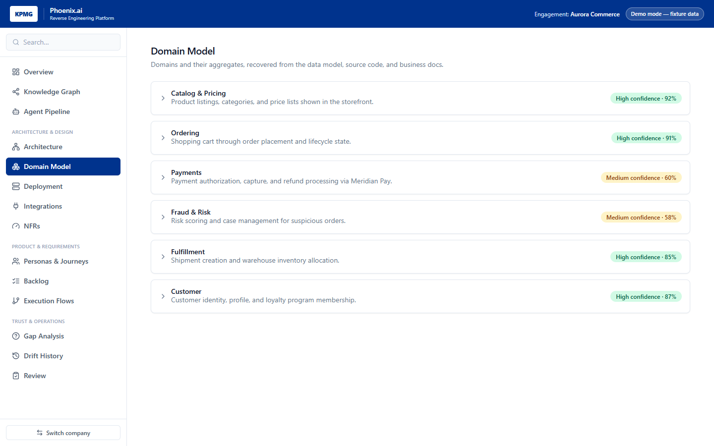
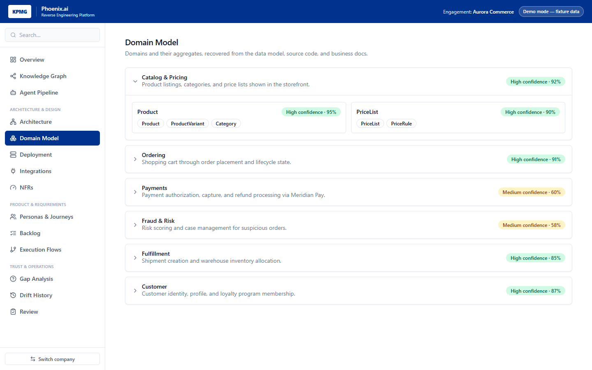
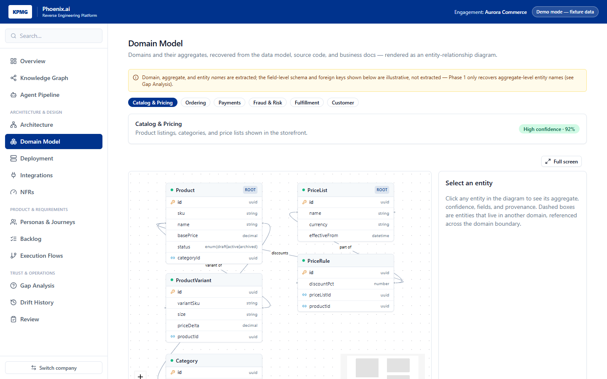
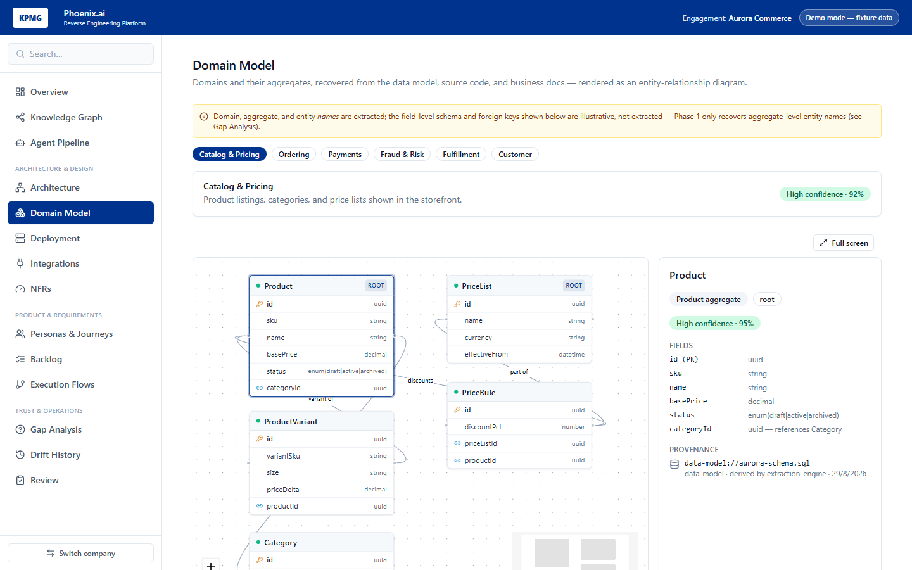

# Domain Model page — ER diagram rendering

Documents a UI-only change to `apps/web`'s Domain Model page: it now renders each domain as an
entity-relationship (ER) diagram instead of a flat expand/collapse list of entity-name badges. No
`apps/api` route, canonical model, or OKF schema changed — this is a presentation change over the
exact same `Domain[]` data `dataProvider.getDomains()` already returned.

## Why

The prior view (`ChevronDown`/`ChevronRight` accordion cards) showed _that_ an aggregate contains
entities, but not _how_ those entities relate to each other or to entities in other domains — the
main thing an ER diagram is for, and the most natural way to review a recovered domain model.

## Before → after

|                   | Before                                            | After                                                                               |
| ----------------- | ------------------------------------------------- | ----------------------------------------------------------------------------------- |
| Layout            | One card per domain, click to expand/collapse     | One domain visible at a time, selected via a badge switcher                         |
| Entities          | Flat `Badge` per entity name, no structure        | `reactflow` node per entity, laid out in columns by aggregate                       |
| Fields            | Not shown at all                                  | Each entity box lists its fields, with PK/FK icons                                  |
| Relationships     | Not shown                                         | Edges between entities, labeled (`"placed by"`, `"line of"`, …)                     |
| Cross-domain refs | Not shown                                         | Dashed external node + edge when an entity references one in another domain         |
| Detail on click   | N/A (nothing was clickable at entity granularity) | Side panel: aggregate, confidence, rationale, fields, cross-domain refs, provenance |
| Fullscreen        | Not available                                     | `FullscreenDiagram` wrapper, reused from the Architecture page                      |

The domain-level confidence badge, description, and per-aggregate confidence/rationale are all
preserved from the old view — nothing about the underlying recovered facts was removed, only how
entities within a domain are presented.

### Before — expand/collapse list

Collapsed, every domain is just a name, description, and confidence badge:

Expanding a domain revealed its aggregates, each a flat set of entity-name badges — no fields, no
relationships, no way to drill into a single entity:

### After — ER diagram

The same domain now renders as an ER diagram: entities as attribute boxes (PK/FK icons, field
types), labeled relationship edges, and an aggregate-column layout, with the domain switcher and
confidence badge preserved above it:

Clicking an entity node populates the side panel with its aggregate, confidence, full field list,
cross-domain references, and provenance:

## What's new

- **`apps/web/src/lib/er-model.ts`** — `buildDomainErModel(activeDomain, allDomains)` turns a
  `Domain` into `{ entities, externals, edges }` for rendering. Resolves each entity's foreign keys
  against _all_ domains (not just the active one) so a reference to an entity that lives in another
  domain renders as a small dashed external node instead of silently dropping.
- **`apps/web/src/components/er-entity-node.tsx`** — `ErEntityNodeComponent`, a custom `reactflow`
  node rendering one entity as a classic ER attribute box (header + field rows with PK/FK icons),
  reusing the existing `CONFIDENCE_COLORS` token from `confidence-badge.tsx` for the header dot.
- **`apps/web/src/pages/DomainModelPage.tsx`** — rewritten to lay out entities in per-aggregate
  columns, wire up `reactflow` (`Background`/`Controls`/`MiniMap`), and drive the new detail panel
  from node-click selection instead of expand/collapse state.

## Important honesty caveat (carried over from the data itself)

Phase 1's `Aggregate.entities` is only a flat `string[]` of entity names — see
`packages/knowledge-graph/src/domain.ts` and ADR 0006, which already documented this as a known gap
("Phase 1 has no real per-entity data, only aggregate-level entity name strings"). No phase between
1 and 5 added field-level schema or foreign-key extraction for entities.

An ER diagram without fields or relationships isn't very useful, so `er-model.ts` fabricates a
plausible field list and FK relationship per known entity name (`ENTITY_FIELDS`/`RELATIONS`), scoped
to the two real fixture companies (Aurora Commerce, the Fintech banking system) already used
elsewhere in this app's mock data. This is clearly labeled in the UI itself — the page's amber notice
banner states that only domain/aggregate/entity _names_ are extracted, and field/FK detail is
illustrative — matching the same "extracted vs. illustrative" distinction ADR 0006 and the Phase 2
sample OKF (`docs/okf/sample.md`) already established. Extending real field/FK extraction remains
future, unscheduled work (would need its own extraction-engine ticket, analogous to P3-07's JPA
entity extraction, generalized beyond Java/JPA).

## Verification

- `pnpm --filter @phoenix-ai/web typecheck` — clean.
- `pnpm --filter @phoenix-ai/web lint` — clean.
- Manual run: `vite` dev server, `/domains` route, both fixture companies — diagram renders, node
  click populates the side panel, domain switcher swaps the diagram, fullscreen toggle works.
